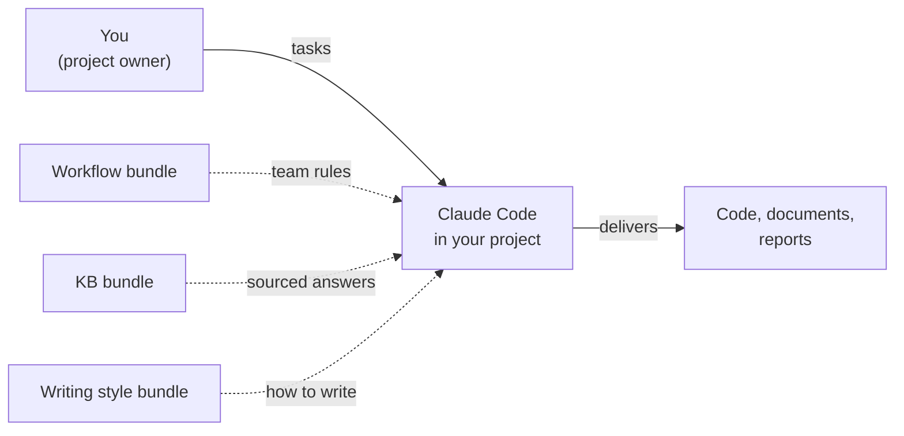
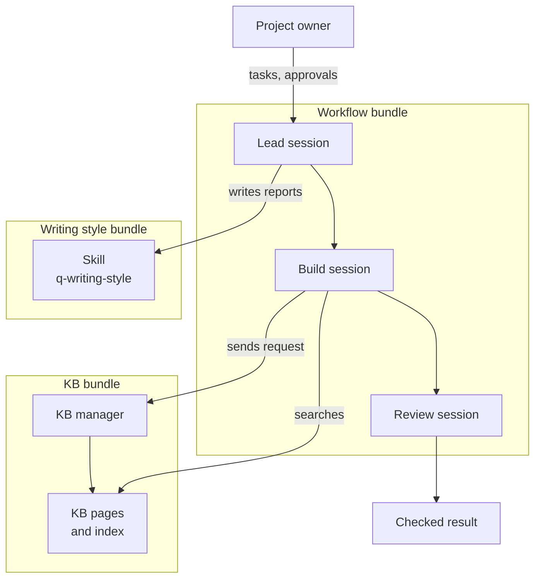

English · [Tiếng Việt](README_VN.md)

# Claude Code Skill Bundles

Three add-on packs for Claude Code. One lets several sessions work as a team, one gives answers about your project with the source named, and one makes all writing and translation follow one style. Install only the packs you need.

License: Apache License 2.0 · Repository: https://github.com/mquan1192/ai-skills

---

## Part 1. In short

### What problem this solves

**Claude Code** is an AI assistant that works inside your project folder: it reads documents, writes code and drafts reports. Without guidance it behaves like a capable new hire who does not know the house rules. Each bundle here gives it one set of rules.

| Bundle | Think of it as | What changes for you |
|---|---|---|
| 👥 **Workflow** | Team rules for several AI sessions | Sessions do not overwrite each other's files. Deletions, settings changes and anything sent outside the project wait for your approval |
| 📚 **KB** (knowledge base) | A project library with one librarian | You ask about the project and get an answer with the page it came from |
| ✍️ **Writing style** | A style guide plus a proofreader | Reports, emails and translations (Japanese, Vietnamese, English) come out short, accurate and in one voice |

The bundles are **independent**. Each has its own installer and works without the other two.

You keep giving Claude Code tasks as before. The bundles you installed decide how it does them.

### Get started in 3 steps

1. Open the [Releases](https://github.com/mquan1192/ai-skills/releases) page and download the zip of the bundle you need.
2. Unzip it into a folder **outside** your project.
3. Open Claude Code in your project and say: *"Read the guide in the bundle folder and install this bundle."*

Claude first shows a list of every file it would add or change. **Nothing is written** until you agree.

You need Claude Code and Python 3. The workflow bundle also needs PowerShell 7. Each installer finds the Python command of your machine (`python`, `python3` or `py -3`); on macOS and Linux start it with `python3`. Any Python version still supported on python.org works; if you use the optional KB model, use Python 3.14, the newest version `onnxruntime` supports as of 2026-11-28 (details in the KB bundle README).

---

## Part 2. Details

### The three bundles

| Bundle | Version | What it does | Guide | Zip on Releases |
|---|---|---|---|---|
| Workflow | 1.1.2 | Roles, a write area per role, approval levels, checked releases for code changes, a one-week sprint | [workflow-skill-bundle](workflow-skill-bundle/README.md) | `Workflow-Skill-Bundle_v1.1.2_20261128.zip` |
| KB | 2.1.0 | Project knowledge as Markdown pages with one writer, and search that names its source | [kb-skill-bundle](kb-skill-bundle/README.md) | `KB-Skill-Bundle_v2.1.0_20261128.zip` |
| Writing style | 1.2.1 | Skill `q-writing-style`: one style for everything Claude writes or translates, facts kept exact, AI phrasing removed, a self-check before saving | [writing-style-bundle](writing-style-bundle/README.md) | `Writing-Style-Bundle_v1.2.1_20261128.zip` |

The KB bundle can also search by meaning with a small offline AI model. The model is a separate zip on the Releases page (`KB-Model_multilingual-e5-small_20261118.zip`). Without it, the KB bundle searches by keyword.

**KB bundle 2.1.0: three ways to install.**

| Profile | For whom | How the KB is written |
|---|---|---|
| `author` (default) | A team, or several Claude sessions | One KB manager session (`KB_Manager`, folder `00_KB_Manager/`) writes; other sessions send `/q-kb-request` |
| `solo` | One person | No manager session; one command, `/q-kb-update`, at the project root |
| `reader` | A machine that only reads | The KB arrives as a data pack |

Choose with `--profile` when installing. Names changed in 2.1.0 and the old ones still work: folder `00_UpdateDocs` is kept where it already exists, `/q-kb-sync` is now `/q-kb-ingest`, and `--profile full` is now `author`.

### How the three work together

The diagram shows a project with all three bundles installed. Each bundle also works alone.

| Arrow | Meaning |
|---|---|
| Project owner → Lead session | You talk only to the lead: give tasks, answer approval questions |
| Build session → KB pages | When a session needs project facts, it searches the KB with `/q-kb-search` instead of rereading every document |
| Build session → KB manager | A new fact goes in as a request with `/q-kb-request`. Only the KB manager changes the KB |
| Lead session → q-writing-style | The workflow bundle names the style skill in its configuration (`writing_style_skill`) and uses it for reports when it is installed |

### How to get a bundle

- **Recommended**: download the bundle's zip from the Releases page, together with its `.sha256` file. The `.sha256` file lets you check that the download is complete and unchanged.
- Or copy the bundle's folder from this repository.
- The "Download ZIP" button on the repository page gets all three bundles at once.

### What all three have in common

- **Install**: the installer first runs a dry run, which only prints the plan, and writes nothing until you agree. Before writing, it checks the SHA-256 fingerprint of every bundle file against `MANIFEST.json` and stops if any file was changed.
- **Uninstall**: removes only files that are still exactly as installed. Files you changed and your data stay.
- **Network**: the installers, scripts, search engine and hooks do not connect to the internet. The one exception is the optional model download script of the KB bundle, which your IT team runs.
- **Where it writes**: only inside the target project folder.
- **Requirements**: Claude Code and Python 3. The workflow scripts and the bundle tests need PowerShell 7.
- **Language**: each bundle has an English `README.md` and a Vietnamese `README_VN.md`. The other documents in the bundles are in Vietnamese. Claude reads them and answers in the language you write in.

## License

Apache License 2.0. The full text is in the `LICENSE` file at the root of the repository and of each bundle.

Copyright 2026 Nguyễn Minh Quân (https://github.com/mquan1192)
