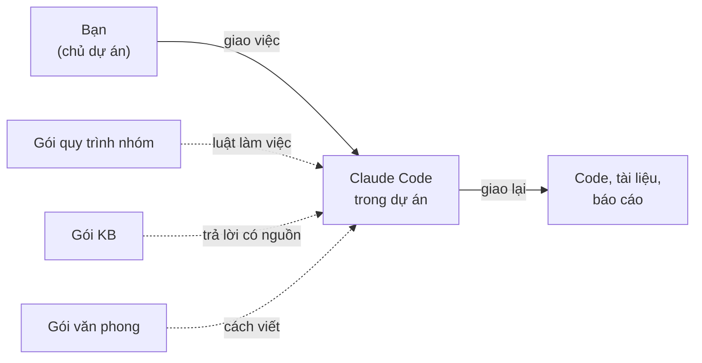
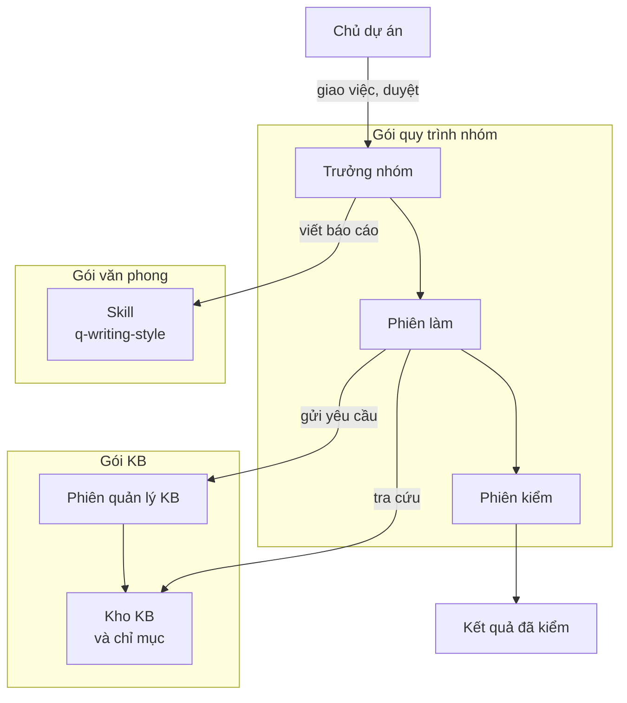

[English](README.md) · Tiếng Việt

# Bộ skill cho Claude Code

Ba gói bổ sung cho Claude Code. Một gói giúp nhiều phiên làm việc như một nhóm, một gói trả lời câu hỏi về dự án kèm nguồn, một gói giúp mọi bài viết và bản dịch theo cùng một văn phong. Cần gói nào thì cài gói đó.

Giấy phép: Apache License 2.0 · Kho mã: https://github.com/mquan1192/ai-skills

---

## Phần 1. Sơ lược

### Giải quyết việc gì

**Claude Code** là trợ lý AI làm việc ngay trong thư mục dự án: đọc tài liệu, viết code, soạn báo cáo. Khi chưa được hướng dẫn, nó giống một nhân viên mới giỏi nhưng chưa biết nội quy. Mỗi gói ở đây cho nó thêm một bộ quy tắc.

| Gói | Hình dung | Bạn được gì |
|---|---|---|
| 👥 **Quy trình nhóm** | Nội quy làm việc nhóm cho nhiều phiên AI | Các phiên không ghi đè file của nhau. Xóa file, đổi cấu hình và mọi thứ gửi ra ngoài dự án đều chờ bạn duyệt |
| 📚 **KB** (kho kiến thức) | Thư viện dự án có một thủ thư | Hỏi về dự án, nhận câu trả lời kèm trang nguồn |
| ✍️ **Văn phong** | Sổ tay văn phong kèm người soát bài | Báo cáo, mail, bản dịch (Nhật, Việt, Anh) gọn, đúng số liệu, cùng một giọng văn |

Ba gói **độc lập**. Mỗi gói có trình cài riêng và chạy được khi không có hai gói kia.

Bạn vẫn giao việc cho Claude Code như trước. Gói nào đã cài thì quyết định cách Claude làm việc đó.

### Bắt đầu trong 3 bước

1. Vào trang [Releases](https://github.com/mquan1192/ai-skills/releases), tải file zip của gói cần dùng.
2. Giải nén ra một thư mục **nằm ngoài** dự án.
3. Mở Claude Code trong dự án và nói: *"Đọc hướng dẫn trong thư mục gói và cài gói này."*

Claude cho bạn xem trước danh sách mọi file sẽ thêm hoặc sửa. **Chưa có gì được ghi** cho tới khi bạn đồng ý.

Máy cần có Claude Code và Python 3. Riêng gói quy trình nhóm cần thêm PowerShell 7. Bộ cài của từng gói tự dò lệnh Python của máy (`python`, `python3` hoặc `py -3`); trên macOS và Linux chạy bộ cài bằng `python3`.

---

## Phần 2. Chi tiết

### Ba gói

| Gói | Bản | Làm gì | Hướng dẫn | Zip ở Releases |
|---|---|---|---|---|
| Quy trình nhóm | 1.1.2 | Vai trò, vùng ghi riêng cho từng vai, mức duyệt, phát hành có kiểm cho thay đổi code, sprint 1 tuần | [workflow-skill-bundle](workflow-skill-bundle/README_VN.md) | `Workflow-Skill-Bundle_v1.1.2_20261128.zip` |
| KB | 2.1.0 | Kiến thức dự án dạng trang Markdown, một người ghi, tìm kiếm có ghi nguồn | [kb-skill-bundle](kb-skill-bundle/README_VN.md) | `KB-Skill-Bundle_v2.1.0_20261128.zip` |
| Văn phong | 1.2.1 | Skill `q-writing-style`: một văn phong cho mọi thứ Claude viết hoặc dịch, giữ đúng sự thật, bỏ giọng văn AI, tự soát trước khi ghi file | [writing-style-bundle](writing-style-bundle/README_VN.md) | `Writing-Style-Bundle_v1.2.1_20261128.zip` |

Gói KB có thể tìm theo nghĩa nhờ một model AI nhỏ chạy offline. Model là file zip riêng ở trang Releases (`KB-Model_multilingual-e5-small_20261118.zip`). Không có model, gói KB vẫn tìm theo từ khóa.

### Ba gói phối hợp thế nào

Sơ đồ dưới là một dự án cài đủ ba gói. Mỗi gói vẫn chạy được một mình.

| Mũi tên | Ý nghĩa |
|---|---|
| Chủ dự án → Trưởng nhóm | Bạn chỉ làm việc với phiên trưởng nhóm: giao việc, trả lời câu hỏi duyệt |
| Phiên làm → Kho KB | Khi cần thông tin dự án, phiên làm tra KB bằng `/q-kb-search` thay vì đọc lại mọi tài liệu |
| Phiên làm → Phiên quản lý KB | Có thông tin mới thì gửi yêu cầu bằng `/q-kb-request`. Chỉ phiên quản lý được sửa KB |
| Trưởng nhóm → q-writing-style | Gói quy trình nhóm ghi tên skill văn phong trong cấu hình (`writing_style_skill`) và dùng skill đó khi viết báo cáo, nếu đã cài |

### Cách lấy một gói

- **Khuyên dùng**: tải zip của gói ở trang Releases, kèm file `.sha256`. File `.sha256` giúp kiểm file tải về đủ và không bị sửa.
- Hoặc chép thư mục của gói từ repo.
- Nút "Download ZIP" trên trang repo tải cả ba gói cùng lúc.

### Điểm chung của ba gói

- **Cài**: installer chạy thử trước (chỉ in kế hoạch) và không ghi gì tới khi bạn đồng ý. Trước khi ghi, installer kiểm dấu vân tay SHA-256 của mọi file trong gói theo `MANIFEST.json`; có file bị sửa thì dừng.
- **Gỡ**: chỉ xóa file còn y nguyên như lúc cài. File bạn đã sửa và dữ liệu của bạn được giữ lại.
- **Mạng**: installer, script, công cụ tìm kiếm và hook không kết nối Internet. Ngoại lệ duy nhất là script tải model tùy chọn của gói KB, do bộ phận IT chạy.
- **Nơi ghi**: chỉ trong thư mục dự án đích.
- **Yêu cầu**: Claude Code và Python 3. Script của gói quy trình nhóm và test của các gói cần PowerShell 7.
- **Ngôn ngữ**: mỗi gói có `README.md` (tiếng Anh) và `README_VN.md` (tiếng Việt). Tài liệu khác trong gói viết bằng tiếng Việt. Claude đọc được và trả lời theo ngôn ngữ bạn dùng.

## Giấy phép

Apache License 2.0. Toàn văn ở file `LICENSE` tại gốc repo và gốc mỗi gói.

Copyright 2026 Nguyễn Minh Quân (https://github.com/mquan1192)
