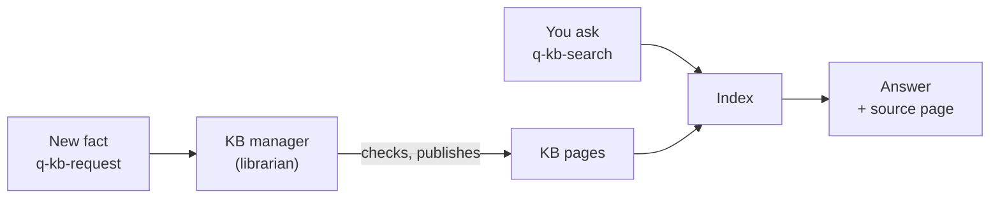
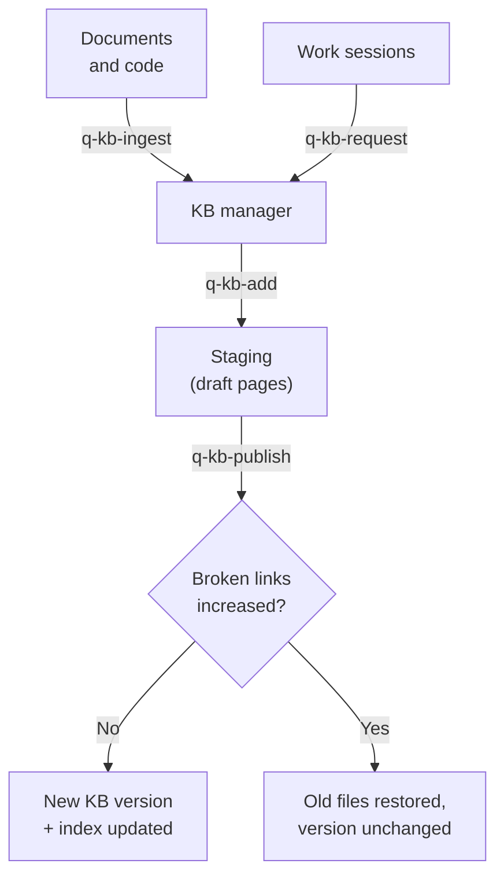
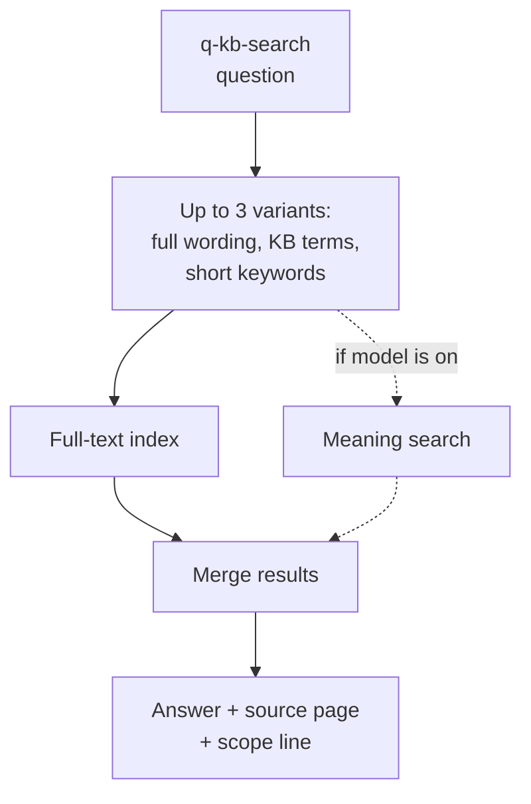

English · [Tiếng Việt](README_VN.md)

# KB Skill Bundle

Gives Claude Code a "project library": project knowledge kept as readable pages, one owner who updates it, and answers that always name their source.

Version 2.1.0 · Search engine: Q-KnowledgeBase 2.1.0-e3 · License: Apache License 2.0 · Repository: https://github.com/mquan1192/ai-skills

This bundle is one of three independent bundles in this repository ([overview](../README.md)). You can install it on its own.

---

## Part 1. In short (for everyone)

### Think of it as a library with a librarian

- The **library** (the KB, short for knowledge base) holds what the team knows about the project: specifications, decisions, terms, notes on the code. Each topic is a page of plain text.
- Anyone may **ask**. Claude looks in the library's index first and answers with the page it came from.
- Only the **librarian** (one Claude session, the KB manager) puts new pages on the shelves. Everyone else hands in a **request slip**.
- Before a new edition goes on the shelves, the librarian checks that no link points to a missing page. If something breaks, the old edition stays.

### Before and after

| Without the bundle | With the bundle |
|---|---|
| Claude rereads many files for every question and may answer from an old or wrong file | Claude searches the index and names the source page and project |
| Anyone can edit the shared notes, so they drift out of date | Only the KB manager changes the KB; every change gets a version number |
| You cannot tell where an answer came from | Every answer ends with the page and the scope it searched |

### How you use it

| You want to | Type in Claude Code |
|---|---|
| Ask a question about the project | `/q-kb-search <question>` |
| Add a new fact or correction | `/q-kb-request <project>/<part> <what to add>` |
| Tell the KB there are new documents or code | `/q-kb-request sync <project>/<part>` |



Questions go through the index and come back with a source. New facts go to the KB manager, who is the only one that changes the pages.

### Get started in 3 steps

1. Download `KB-Skill-Bundle_v2.1.0_20261128.zip` from the [Releases](https://github.com/mquan1192/ai-skills/releases) page and unzip it **outside** your project.
2. Open Claude Code in your project and say: *"Read `README_VN.md` section 3 in the bundle folder and install this bundle."* Claude shows you the plan first and installs only after you agree.
3. Restart Claude Code, then set up the KB manager session once (`README_VN.md` section 5). Working alone? Install with `--profile solo`: no manager session, and one command, `/q-kb-update`, writes the KB.

**Optional: search by meaning.** A small AI model that runs offline on your computer lets the KB find pages even when your question uses different words or another language. It is off by default. The model is a separate zip on the Releases page (`KB-Model_multilingual-e5-small_20261118.zip`); put it next to the bundle zip and the installer finds it.

---

## Part 2. Details

### Building blocks

| Part | What it is |
|---|---|
| **Claude Code** | Anthropic's AI assistant that works inside a project folder; it reads and writes files and runs commands within the permissions you set |
| **KB** | Markdown pages in the `kb/` folder. Markdown is plain text with light formatting, readable in any editor |
| **Skills** (6) | Instruction folders Claude loads when needed. `q-kb-search` and `q-kb-request` are for every session. `q-kb-ingest` (named `q-kb-sync` up to 2.0.5; the old command still works), `q-kb-add` and `q-kb-publish` exist only in the KB manager's folder, so other sessions cannot run them. `q-kb-update` comes only with the solo install: one command that does all three |
| **Install profiles** | `author` (default): one KB manager session writes, the others send requests. `solo`: one person, no manager session, `/q-kb-update` at the project root. `reader`: read-only, the KB arrives as a data pack |
| **Search engine** | Q-KnowledgeBase, a Python program that builds an index of the KB with SQLite full-text search (built into Python). Like the index of a book, it lists which words are in which section of which page, so a search does not read every file |
| **Model** (optional, experimental) | multilingual-e5-small, runs on the CPU, offline. Adds search by meaning (VI / EN / JA). Needs `onnxruntime` and `numpy`, installed by IT. Without it the engine falls back to keyword search |
| **Hooks** | Small programs Claude Code runs at fixed moments: a status line when a session opens (KB version, new sources not yet added) and reminders to use the index before searching files by hand. They never change the KB, never block Claude and never record what you type |
| **Data packs** | One project's KB exported as a zip and imported read-only on another computer |

### Update path: how knowledge gets into the KB



The KB manager collects sources and requests, writes draft pages, then publishes. Publishing counts broken links before and after; if the count grows, the old files come back and the version stays the same.

### Question path: how a question is answered



Search reads only the published KB, never the raw source documents. Each answer ends with a `🔎` line that names the KB scope searched.

### Hooks: three modes

| Mode | What happens |
|---|---|
| observe (default after install) | Shows nothing; only logs what it would have shown, so you can check it for about a week |
| on | Shows the status line and reminders; when new sources appear, files one request to add them |
| off | Does nothing and logs nothing |

The mode is the `hooks.mode` key in `kb.config.json`. Details: `README_VN.md` section 8.

### What is inside

| Part | Content |
|---|---|
| `README_VN.md` | Full guide: install, model choice, manager session, daily use, hooks, upgrade, uninstall, data packs |
| `skills/` | The six KB skills and the `q-kb-sync` alias |
| `engine/` | The Q-KnowledgeBase search engine |
| `hooks/` | `kbwatch.py`, `kbroute.py`, `kbguard.py` and their hook settings |
| `templates/` | KB page templates, an empty KB, the request template, the default data policy, the example configuration |
| `tools/` | `kbpack.py` (data packs), model download scripts for IT, the manifest builder |
| `docs/` | Engine documents and the model download guide |
| `install.py` | Installer, upgrade, roll back and uninstall |

### Requirements

- Claude Code (command line or desktop app). Tested with 2.1.325; the minimum version is not known.
- Python 3.10 or later, standard library only, with SQLite full-text search (FTS5).
- Python command: the installer finds it on your machine. It tries the command already used in the project, then `python`, `python3` and `py -3`, and writes the first one that really runs into the hook commands. On macOS and Linux, start the installer with `python3`. To choose the command yourself, add `--python <command or path>`.
- Recommended version: a release in the bug-fix phase on python.org (3.14 and 3.15 as of 2026-11-28). Python 3.10 reached end of life in October 2026.
- Windows, macOS or Linux.
- The optional model needs `onnxruntime` and `numpy`, installed by IT, and roughly 0.5 to 2.3 GB of disk (estimate). Use a Python version that `onnxruntime` supports: on 2026-11-28, onnxruntime 1.32.0 on PyPI covers Python 3.11 to 3.14 and not yet 3.15, so use 3.14 with the model. If that Python lives in a virtual environment, install with `--python <path to the venv python>`.

### Install

1. Unzip the bundle in a folder outside your project.
2. Ask Claude Code: "Read `README_VN.md` section 3 in the bundle folder and install this bundle."
3. Claude first runs a **dry run**, which only prints the plan: files to add, keep or replace, conflicts, and changes to `.claude/settings.json`. If a choice is missing (for example whether to use a model), the installer prints the question with pros and cons and stops.
4. After you agree, Claude runs the real install (`--apply --yes` with your choices).
5. Restart the Claude Code session so the new skills and hooks load.
6. Create the KB manager session once (`README_VN.md` section 5).

Before writing, the installer checks the SHA-256 fingerprint of every bundle file (a code that changes if a single byte changes) against `MANIFEST.json` and stops if the bundle was changed. It backs up every file it will replace to `.qkb/backups/`. In `.claude/settings.json` it only adds hook entries and permissions for read-only search commands; it removes no line. It does not touch `CLAUDE.md`, `settings.local.json` or other plugins.

### Uninstall

```powershell
python -E -s -B install.py --target <project folder> --uninstall               # dry run (macOS / Linux: python3)
python -E -s -B install.py --target <project folder> --uninstall --apply --yes   # remove
```

It removes bundle files that are still as installed, the permissions it added and its hook entries. It keeps your data: `kb/`, `.qkb/` (index, settings, backups), the manager folder and the logs. `--restore-previous` puts back the version before the last install. Details: `README_VN.md` section 9.

### Safety

- No network: the installer, engine and hooks never connect to the internet and never install packages.
- Search log: the engine writes one line per search to a log on your computer, by default with the search text. You can turn the text or the whole log off (`usage_log` in `.qkb/config.json`).
- Writes only inside the target project folder; refuses paths that lead outside it.
- Default data policy: no passwords, keys or personal data in the KB, and no copying between projects. A project can add rules but not relax the defaults.
- Data packs: before export, the tool scans for credentials (stops without printing the value), personal data, absolute paths and mentions of other projects. Import accepts only Markdown and images, checks every file's SHA-256 and keeps the imported pages read-only.
- Details: `SECURITY.md`.

### Language of the documentation

This README is in English. All other documents in the bundle (skills, `README_VN.md`, `SECURITY.md`, templates) are in Vietnamese. Claude reads them in any case and answers in the language you write in.

## License

Apache License 2.0. The full text is in the `LICENSE` file.

Copyright 2026 Nguyễn Minh Quân (https://github.com/mquan1192)
