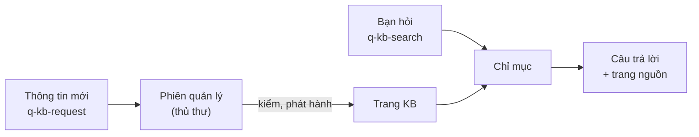
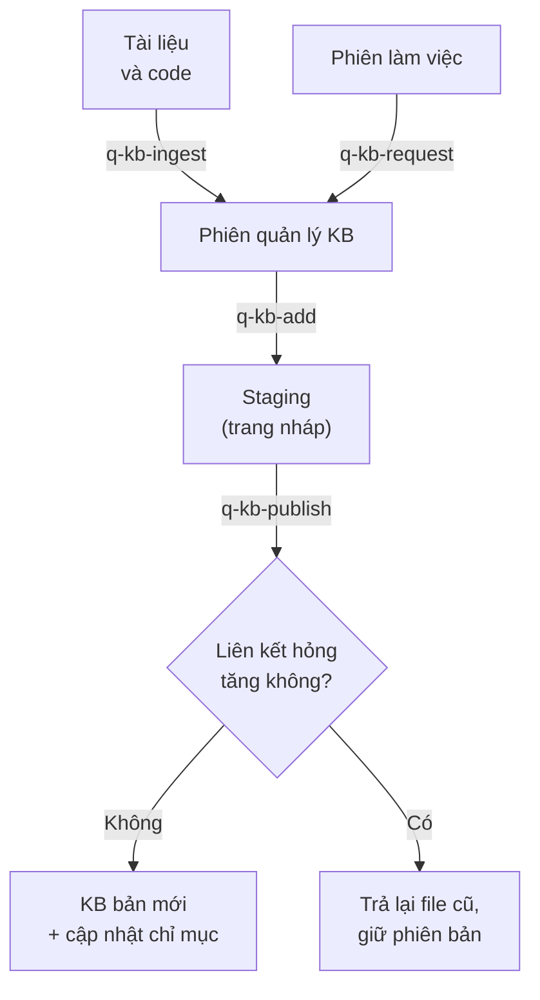
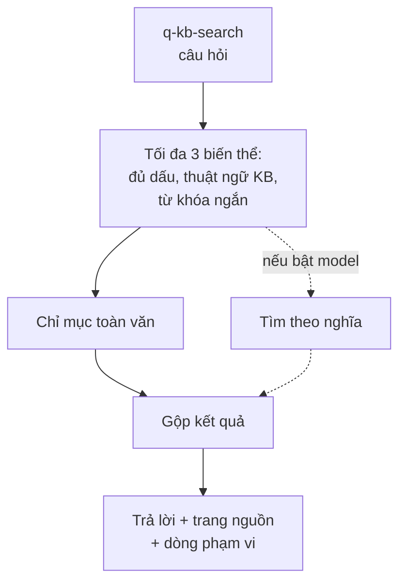

[English](README.md) · Tiếng Việt

# Bộ skill KB: hướng dẫn sử dụng

Cho Claude Code một "thư viện dự án": kiến thức dự án nằm thành các trang dễ đọc, một người phụ trách cập nhật, và câu trả lời nào cũng ghi rõ nguồn.

Bản 2.1.0 · File gói: `KB-Skill-Bundle_v2.1.0_<yyyyMMdd>.zip` · Công cụ tìm kiếm: Q-KnowledgeBase 2.1.0-e3 (dòng 2.1.x) · Giấy phép: Apache License 2.0 (file `LICENSE`; Copyright 2026 Nguyễn Minh Quân (https://github.com/mquan1192)) · Kho mã: https://github.com/mquan1192/ai-skills

Gói này là một trong ba gói độc lập của repo ([tổng quan](../README_VN.md)); cài riêng được.

---

## Phần 1. Sơ lược (ai cũng đọc được)

### Hình dung: một thư viện có thủ thư

- **Thư viện** (gọi là KB, viết tắt của knowledge base, kho kiến thức) chứa những gì nhóm biết về dự án: đặc tả, quyết định, thuật ngữ, ghi chú về code. Mỗi chủ đề là một trang văn bản thường.
- Ai cũng được **hỏi**. Claude tra mục lục của thư viện trước, rồi trả lời kèm trang nguồn.
- Chỉ **thủ thư** (một phiên Claude riêng, gọi là phiên quản lý KB) được xếp trang mới lên kệ. Người khác nộp **phiếu yêu cầu**.
- Trước khi đưa bản mới lên kệ, thủ thư kiểm xem có liên kết nào trỏ tới trang không tồn tại không. Có lỗi thì giữ nguyên bản cũ.

### Trước và sau khi cài

| Chưa có gói | Có gói |
|---|---|
| Claude đọc lại nhiều file cho mỗi câu hỏi, có thể trả lời theo file cũ hoặc nhầm file | Claude tra chỉ mục, ghi rõ trang nguồn và dự án |
| Ai cũng sửa ghi chú chung, lâu dần sai lệch | Chỉ phiên quản lý sửa KB; mỗi lần thay đổi có số phiên bản |
| Không biết câu trả lời lấy từ đâu | Cuối mỗi câu trả lời có trang nguồn và phạm vi đã tra |

### Bạn dùng thế nào

| Muốn làm gì | Gõ trong Claude Code |
|---|---|
| Hỏi về dự án | `/q-kb-search <câu hỏi>` |
| Thêm hoặc sửa một thông tin | `/q-kb-request <dự án>/<phần> <nội dung>` |
| Báo có tài liệu / code mới | `/q-kb-request sync <dự án>/<phần>` |



Câu hỏi đi qua chỉ mục và quay về kèm nguồn. Thông tin mới đi tới phiên quản lý KB, phiên duy nhất được sửa các trang.

### Bắt đầu trong 3 bước

1. Tải `KB-Skill-Bundle_v2.1.0_20261128.zip` ở trang [Releases](https://github.com/mquan1192/ai-skills/releases), giải nén ra **ngoài** dự án.
2. Mở Claude Code trong dự án và nói: *"Đọc mục 3 của `README_VN.md` trong thư mục gói và cài gói này."* Claude cho xem kế hoạch trước, chỉ cài khi bạn đồng ý.
3. Khởi động lại Claude Code, rồi tạo phiên quản lý KB một lần (mục 5). Dùng một mình thì cài dạng `solo`: không cần phiên này, ghi KB bằng một lệnh `/q-kb-update` (mục 5).

**Tùy chọn: tìm theo nghĩa.** Một model AI nhỏ chạy offline trên máy giúp KB tìm được trang ngay cả khi câu hỏi dùng chữ khác hoặc ngôn ngữ khác. Mặc định tắt. Model là file zip riêng ở trang Releases (`KB-Model_multilingual-e5-small_20261118.zip`); đặt cạnh file zip của gói thì installer tự tìm thấy (mục 4).

---

## Phần 2. Chi tiết

### Các thành phần

| Thành phần | Là gì |
|---|---|
| **Claude Code** | Trợ lý AI của Anthropic, làm việc trong thư mục dự án; đọc, ghi file và chạy lệnh trong phạm vi quyền được cấp |
| **KB** | Các trang Markdown trong thư mục `kb/`. Markdown là văn bản thường có định dạng nhẹ, mở bằng trình soạn thảo nào cũng đọc được |
| **Skill** (6) | Thư mục hướng dẫn Claude nạp khi cần. `q-kb-search`, `q-kb-request` cho mọi phiên. `q-kb-ingest` (tên cũ `q-kb-sync`, vẫn gõ được), `q-kb-add`, `q-kb-publish` chỉ có trong thư mục của phiên quản lý, nên phiên khác không chạy được. `q-kb-update` chỉ có ở dạng cài `solo`: một lệnh làm cả ba việc ghi |
| **Công cụ tìm kiếm** | Q-KnowledgeBase, chương trình Python dựng chỉ mục cho KB bằng tìm kiếm toàn văn của SQLite (có sẵn trong Python). Giống mục lục tra cứu cuối sách: ghi từ nào nằm ở mục nào của trang nào, nên khi tìm không phải đọc mọi file |
| **Model** (tùy chọn, thử nghiệm) | multilingual-e5-small, chạy trên CPU, offline. Thêm cách tìm theo nghĩa (VI / EN / JA). Cần `onnxruntime` và `numpy` do IT cài. Không có model thì engine tự quay về tìm theo từ khóa |
| **Hook** | Chương trình nhỏ Claude Code tự chạy vào thời điểm cố định: in dòng trạng thái khi mở phiên (phiên bản KB, nguồn mới chưa nạp) và nhắc dùng chỉ mục trước khi tự tìm file. Không sửa KB, không chặn Claude, không ghi câu bạn gõ |
| **Gói dữ liệu** | KB của một dự án xuất thành file zip, nhập ở máy khác dưới dạng chỉ đọc (mục 13) |

### Đường cập nhật: kiến thức vào KB thế nào



Phiên quản lý gom nguồn và yêu cầu, viết trang nháp, rồi phát hành. Bước phát hành đếm liên kết hỏng trước và sau; số đếm tăng thì trả lại file cũ, phiên bản giữ nguyên.

### Đường hỏi đáp: câu hỏi được trả lời thế nào



Lệnh tra chỉ đọc KB đã phát hành, không đọc tài liệu gốc. Mỗi câu trả lời kết thúc bằng dòng `🔎 Phạm vi KB: …` (mục 7).

### Chỉ cài gói cần dùng

Gói này không cần hai gói kia của repo: gói có `install.py` riêng. Để lấy riêng gói này: tải `KB-Skill-Bundle_v2.1.0_20261128.zip` ở trang Releases kèm file `.sha256` để kiểm file tải về, hoặc chép thư mục `kb-skill-bundle/` từ repo. Nút "Download ZIP" trên trang repo tải cả ba gói.

### Tóm tắt yêu cầu, an toàn, gỡ

- **Yêu cầu**: Claude Code; Python 3.10+ có SQLite FTS5; Windows, macOS hoặc Linux (mục 2).
- **An toàn**: không dùng mạng, chỉ ghi trong thư mục dự án, sao lưu trước khi thay file, không sửa `CLAUDE.md` và `settings.local.json`. Engine ghi log mỗi lần tìm trên máy, mặc định có câu tìm; tắt được bằng `usage_log` trong `.qkb/config.json` (mục 11, `SECURITY.md`).
- **Gỡ**: `python -E -s -B install.py --target <thư mục dự án> --uninstall` (chạy thử), thêm `--apply --yes` để gỡ thật; giữ nguyên dữ liệu `kb/`, `.qkb/`, thư mục quản lý và log (mục 9).
- **Ngôn ngữ**: tài liệu trong gói viết bằng tiếng Việt; Claude đọc được và trả lời theo ngôn ngữ người dùng.

Hướng dẫn đầy đủ: các mục 1–13 bên dưới.

## Mục lục

1. Bộ này làm gì
2. Cần có trước khi cài
3. Cài đặt
4. Chọn cách tìm: có / không model
5. Tạo phiên quản lý KB
6. Dùng hằng ngày
7. Chọn phạm vi tìm
8. Hook: hiện gì, 3 chế độ, cách tắt
9. Nâng cấp, lùi lại, gỡ
10. Lỗi thường gặp
11. Giới hạn đã biết, bảo mật, chạy cùng plugin bảo vệ
12. Công cụ khác (Codex)
13. Skill và dữ liệu nằm tách nhau; gói dữ liệu KB

## 1. Bộ này làm gì

- Lưu kiến thức dự án thành các trang Markdown trong thư mục `kb/` (gọi là KB).
- Tra nhanh KB bằng 1 lệnh `/q-kb-search`: chỉ đọc, tra chỉ mục trước, ghi nguồn, ghi rõ kết quả thuộc dự án nào.
- Ghi KB theo quy trình 1 người ghi:
  - Phiên làm việc gửi yêu cầu bằng `/q-kb-request`.
  - Phiên quản lý KB nạp nguồn, thêm thông tin, phát hành (`/q-kb-ingest`, `/q-kb-add`, `/q-kb-publish`).
  - Dùng một mình (dạng cài `solo`): không có phiên quản lý; gõ `/q-kb-update` ở gốc dự án.
- Hook tự nhắc: báo trạng thái KB khi mở phiên, báo khi có nguồn mới chưa nạp.
- Khuôn trang KB và script dựng KB rỗng cho dự án mới.
- Chạy hoàn toàn trên máy. Script cài không gọi mạng, không tải thêm gì.

## 2. Cần có trước khi cài

- Claude Code (CLI hoặc app Desktop, tab Code). Bản đã thử: 2.1.325. Bản tối thiểu: chưa xác định.
- Python 3.10 trở lên (chỉ dùng thư viện chuẩn), SQLite có FTS5.
- Lệnh gọi Python: bộ cài tự dò trên máy. Thứ tự thử: lệnh đang dùng trong dự án, rồi `python`, `python3`, `py -3`; lệnh đầu tiên chạy được sẽ được ghi vào lệnh hook. Trên macOS và Linux, chạy bộ cài bằng `python3`. Muốn tự chọn lệnh: thêm `--python <lệnh hoặc đường dẫn>`. Lệnh này cũng được ghi vào quyền chạy lệnh đọc và `qkb_command` trong `kb.config.json`. Các lệnh mẫu trong tài liệu này viết `python`; máy dùng lệnh khác thì thay tương ứng.
- Bản nên dùng: bản đang ở giai đoạn sửa lỗi (bugfix) trên python.org (3.14 và 3.15, tính đến 28/11/2026). Python 3.10 đã hết hỗ trợ từ tháng 10/2026.
- Khi dùng model: chọn bản Python mà `onnxruntime` hỗ trợ. Ngày 28/11/2026, onnxruntime 1.32.0 trên PyPI có bản cho Python 3.11 đến 3.14, chưa có cho 3.15, nên dùng 3.14. Python đó nằm trong venv thì cài kèm `--python <đường dẫn python của venv>`.
- Quyền ghi trong thư mục dự án.
- Windows, macOS hoặc Linux.

Chưa hỗ trợ:

- Cài cho toàn máy. Bản này chỉ cài theo từng dự án.
- Dạng plugin của Claude Code. Bản 2.0 cài bằng script chép file (xem mục 12).

Kiểm tra sau khi cài:

```bash
python -E -s -B .claude/skills/q-knowledgebase/scripts/qkb.py doctor
```

## 3. Cài đặt

Chạy trong thư mục đã giải nén gói (`kb-skill-bundle/`). Ví dụ dưới dùng dự án `demo`, phần `core`, thư mục đích `D:\work\demo`.

Cấu trúc gói:

```text
kb-skill-bundle/
  README_VN.md   CHANGELOG.md   SECURITY.md   MANIFEST.json   install.py
  engine/      skills/      hooks/      templates/
  scripts/     tools/       manifests/  docs/engine/   tests/
```

Script cài:

- Chỉ dùng thư viện chuẩn, chỉ ghi trong thư mục đích, không tạo phiên.
- Không sửa `settings.local.json`, `CLAUDE.md`, plugin khác.
- Không có `--apply` thì chỉ in kế hoạch, không ghi gì (dry-run là mặc định).

**Bước 1. Xem trước (chưa ghi gì)**

```powershell
python -E -s -B install.py --target "D:\work\demo"
```

Mẫu kết quả:

```text
BỘ SKILL KB 2.1.0 (engine 2.1.0-e3) — KẾ HOẠCH CÀI (chưa ghi gì)
Đích: D:\work\demo   ·   Hiện trạng: chưa cài
1. File sẽ thêm: 96      (engine 58 · skill 9 · skill quản lý 6 · hook 5 · khuôn 18)
2. File giữ nguyên: 0   ·   File sẽ thay: 0   ·   Xung đột: 0
3. .claude/settings.json: thêm 5 khối hook (sau các khối đang có), thêm 8 quyền chạy lệnh đọc; dòng bị xóa: 0
4. KB rỗng: kb/demo/core/, projects/demo/core/, 00_KB_Manager/ (14 mục)
5. Lựa chọn: dạng cài = người soạn (có phiên quản lý KB) · model = không · hook = quan sát (chỉ ghi log) · phiên quản lý = KB_Manager (00_KB_Manager/)
6. Sao lưu sẽ tạo: .qkb/backups/install-20260105-093000/
Chi tiết từng file: thêm --format json
```

Số file trong mẫu chỉ để minh họa; số thật phụ thuộc gói.

**Bước 2. Cài**

```powershell
python -E -s -B install.py --target "D:\work\demo" --apply --yes --model none --project demo --sub core
```

- Chạy không có bàn phím (ví dụ Claude gọi qua công cụ): phải có `--apply --yes` và mọi lựa chọn bằng cờ.
- Thiếu lựa chọn (ví dụ `--model`): script in câu hỏi kèm ưu / nhược điểm, dừng, chưa ghi gì (mã thoát 3).
- Có bàn phím: script hỏi xác nhận, gõ `CO` để ghi.
- Trước khi ghi, script sao lưu vào `.qkb/backups/install-<yyyyMMdd-HHmmss>/` (file sẽ thay, `.claude/settings.json`, `.qkb/config.json`, `kb.config.json`).
- Sau khi ghi, script chạy `qkb doctor`, `build` hoặc `update`, `verify --links`, rồi ghi biên bản vào `.qkb/install/installed.json`.

**Bước 3. Khởi động lại phiên**

- Đóng và mở lại phiên Claude Code của dự án. Hook và skill mới chỉ có hiệu lực từ phiên mới.

**Các tham số**

| Tham số | Ý nghĩa | Mặc định |
|---|---|---|
| `--target <thư mục>` | Thư mục gốc dự án đích (bắt buộc) | — |
| `--dry-run` | Chỉ in kế hoạch | Bật khi không có `--apply` |
| `--apply` | Ghi thật | Tắt |
| `--yes` | Không hỏi lại (bắt buộc khi không có bàn phím) | Tắt |
| `--components <danh sách>` | `engine`, `skills`, `hooks`, `scaffold` | Tất cả (`scaffold` chỉ khi chưa có `kb/`) |
| `--project`, `--sub` | Tên dự án / phần cho KB rỗng | Hỏi; `--sub` = `main` |
| `--manager-folder`, `--session-name` | Thư mục và tên phiên quản lý KB | `00_KB_Manager`, `KB_Manager`. Dự án đã cài bản ≤ 2.0.5 (đang có `00_UpdateDocs/`): giữ nguyên tên đang dùng |
| `--model none\|local` | Lựa chọn model (mục 4) | Hỏi; không trả lời thì dừng |
| `--model-zip <zip>` | Với `--model local`: đặt model từ file zip của IT (mục 4). Không cần khi file zip đặt cạnh bộ skill (tự nhận) | — |
| `--hooks observe\|off` | Chế độ hook lúc cài (không có `on`) | `observe` |
| `--profile author\|solo\|reader` | `author`: máy soạn KB, có phiên quản lý riêng (tên cũ `full`, vẫn nhận). `solo`: một người dùng, ghi KB bằng `/q-kb-update` ở gốc dự án, không cần phiên quản lý (mục 5). `reader`: máy chỉ đọc KB nhận qua gói dữ liệu (mục 13) | `author`; cài lại mà không ghi thì giữ dạng của lần trước |
| `--adopt` | Cho phép thay file đang có mà gói không nhận ra (sau sao lưu) | Tắt |
| `--migrate` | Cho phép nâng cấu trúc chỉ mục cũ | Tắt (chỉ in lệnh) |
| `--uninstall` | Gỡ theo biên bản cài | — |
| `--restore-previous` | Trả lại bản trước lần cài gần nhất | — |
| `--format text\|json` | Dạng in | `text` |

**Mã thoát**

| Mã | Nghĩa |
|---|---|
| 0 | Xong (hoặc dry-run không có vấn đề) |
| 1 | Có xung đột cần người quyết định; chưa ghi gì |
| 2 | Sai tham số, thiếu môi trường, gói lệch mã kiểm tra, bản đang cài mới hơn gói; chưa ghi gì |
| 3 | Thiếu lựa chọn hoặc thiếu xác nhận; đã in câu hỏi; chưa ghi gì |
| 4 | Lỗi khi ghi hoặc khi kiểm sau cài; đã lùi lại đủ |
| 5 | Lỗi và lùi lại không đủ; script in danh sách file cần chép lại từ thư mục sao lưu |

**Ghép `.claude/settings.json`**

- Khối hook của gói được thêm sau các khối đang có của cùng sự kiện. Sự kiện đã có lệnh gọi cùng script KB (khối giống hệt, hoặc khối bạn đã sửa `timeout` / `matcher`) thì không thêm lần hai.
- Lệnh hook ở dạng an toàn: `python -I -S -c "…"` kiểm có `.claude/hooks/<script>` rồi mới chạy; thiếu file thì thoát 0, không chặn prompt / tool. Lệnh KB dạng cũ đang có được đổi tại chỗ sang dạng này (§ 9).
- Quyền chạy lệnh đọc (`status`, `search`, `query`, `explore`, `read`, `related`, `path`, `impact`, `map`, và `kbscope.py`) được thêm vào `permissions.allow`. Không đụng `ask`, `deny`.
- Trước khi ghi, script kiểm: mọi giá trị đang có còn nguyên; số dòng bị xóa = 0. Không đạt thì không ghi (mã 4).
- Nếu file không đọc được như JSON: script không sửa, in đoạn cần dán và hướng dẫn dán tay.
- File được ghi lại với thụt lề 2 ký tự, khoảng trắng có thể đổi dù nội dung giữ nguyên. Bản gốc có trong thư mục sao lưu.
- Quyền `allow` hiện chỉ có dạng `Bash(…)`. Trên Windows nếu lệnh chạy qua PowerShell mà vẫn bị hỏi quyền: chưa xác minh; cần thử khi dùng.

**Dự án chưa có KB**

Script dựng sẵn `kb/` rỗng, chỉ mục rỗng, thư mục quản lý. Sau đó:

- Chép tài liệu gốc vào `projects/demo/core/docs/`, code vào `projects/demo/core/src/`.
- Tạo phiên quản lý KB (mục 5).
- Gõ `/q-kb-request sync demo/core` ở phiên làm việc, rồi `/q-kb-ingest demo/core` ở phiên quản lý.

**Dùng một mình (dạng solo)**

```powershell
python -E -s -B install.py --target "D:\work\demo" --profile solo --apply --yes --model none --project demo --sub core
```

- Cài như dạng người soạn, khác 2 điểm: 3 skill ghi KB nằm ở `.claude/skills/` gốc dự án, và thêm skill `q-kb-update`.
- Không cần tạo phiên quản lý. Chép tài liệu vào `projects/demo/core/docs/` rồi gõ `/q-kb-update demo/core`.
- Thư mục quản lý vẫn được dựng: nơi để bản nháp (`staging/`), khoá (`locks/`), yêu cầu (`requests/`) và cấu hình.

**Máy chỉ đọc KB (dạng người đọc)**

```powershell
python -E -s -B install.py --target "D:\work\demo" --profile reader --apply --yes --model none
```

- Cài: engine, `q-kb-search`, `q-kb-request`, hook, công cụ gói dữ liệu `.claude/tools/kbpack.py`.
- Không cài 3 skill ghi KB, không dựng thư mục quản lý; cấu hình nằm ở `kb.config.json` gốc dự án.
- Sau đó nhập gói dữ liệu nhận được (mục 13).

## 4. Chọn cách tìm: có / không model

Hỏi 1 lần lúc cài. Lựa chọn ghi vào `kb.config.json` (`search.model`: `none` hoặc `local`) và, khi đã có model, vào `.qkb/config.json` (`embedding.backend`).

Nội dung script in trước khi chọn:

```text
CHỌN CÁCH TÌM KIẾM
[1] Không dùng model (mặc định, khuyên dùng)
    + Không tải, không cài thêm; chạy trên mọi máy; đúng chính sách công ty.
    + Nhanh; kết quả giải thích được và luôn giống nhau.
    + Tốt với số, mã, tên hàm, thuật ngữ chính xác.
    - Yếu khi câu hỏi diễn đạt khác hẳn tài liệu, hoặc dùng từ đồng nghĩa chưa có trong bảng thuật ngữ.
    - Hỏi khác ngôn ngữ của KB: phụ thuộc bảng thuật ngữ và các biến thể câu hỏi do Claude viết.
[2] Có model chạy trên máy (thử nghiệm)
    + Hiểu nghĩa: diễn đạt khác, đồng nghĩa, Việt ↔ Anh ↔ Nhật; ít phải chăm bảng thuật ngữ.
    - Phải tự tải 0,5–2,3 GB và phải được công ty cho phép.
    - Mỗi lần tìm nạp model 1–3 giây; dựng vector lần đầu vài phút tới khoảng 1 giờ; tốn RAM và đĩa.
    - Kết quả khó giải thích; yếu với số và mã.
    - Cần model đã tải (IT: tools/download-models) và 2 gói Python onnxruntime + numpy trên máy (IT cài).
```

**Bật model (thử nghiệm)**

1. Máy có mạng (IT): tải model và đóng 1 file zip:

```powershell
pwsh -NoProfile -ExecutionPolicy Bypass -File tools\download-models.ps1 -Zip "E:\KB-Model_multilingual-e5-small_20260105.zip" -Apply
```

2. Cách dễ nhất: đặt file zip model cạnh file zip bộ skill (cùng thư mục), giải nén bộ skill, rồi chạy `install.py` như thường, không cần thêm tham số. Script tự tìm `KB-Model_*.zip` ở: thư mục bộ skill, thư mục chứa nó, và thư mục `models/` trong 2 chỗ đó.
   - Đúng 1 file hợp lệ (zip an toàn, mã sha256 khớp `MODEL.txt`) → dùng như `--model local --model-zip <file>`; bản kế hoạch ghi rõ tên file ("Tìm thấy model: …").
   - File không hợp lệ → bỏ qua, có ghi chú. Từ 2 file hợp lệ trở lên → dừng, liệt kê, không tự chọn.
   - `--model none` luôn thắng: thấy file zip cũng không dùng.

   Hoặc chỉ rõ file zip (hoặc dùng `download-models.ps1 -Target <dự án> -FromZip <zip> -Apply`):

```powershell
python -E -s -B install.py --target "D:\work\demo" --apply --yes --model local --model-zip "E:\KB-Model_multilingual-e5-small_20260105.zip"
```

3. Dựng vector 1 lần (vài phút, file riêng; chỉ mục thường không đổi):

```powershell
python -E -s -B .claude/skills/q-knowledgebase/scripts/qkb.py embed --apply
```

Điều cần biết:

- Mặc định: `none` (không dùng model).
- Model đặt ở `.qkb/models/<tên model>/` kèm `MODEL.txt` (sha256 từng file). Engine kiểm mã trước khi dùng; chỉ mở file `.onnx` / `.json`; chạy trên CPU, offline.
- Chế độ dùng model: `embedding.mode` trong `.qkb/config.json` = `auto` (mặc định: chỉ khi câu hỏi cần), `on` hoặc `off`. Script cài không đổi chế độ này.
- Thiếu `onnxruntime` / `numpy` hoặc model lỗi: engine tự quay về cách tìm thường, không dừng.
- Đổi lựa chọn bất cứ lúc nào: chạy lại `install.py` với `--model none` hoặc `--model local`. Không phải cài lại KB hay dựng lại chỉ mục. `none` tắt model ngay.
- Với model, mỗi lần tìm chậm thêm khoảng 1–3 giây (ước tính).
- Log sử dụng của engine: khóa `usage_log` trong `.qkb/config.json`. Từ 2.0.2, `install.py` bật sẵn `{"path": "process-log/kb-usage", "query_text": true}` nếu dự án chưa tự đặt khóa này (đã đặt thì giữ nguyên); muốn tắt: đặt `"path": ""`. Mỗi lệnh tìm ghi 1 dòng: lệnh, phạm vi, cách tìm, có dùng model, thời gian, số kết quả, cờ trượt; không ghi nội dung kết quả. `query_text: true` thì ghi cả câu tìm (nằm trên máy); không muốn thì đặt `false`.
- File zip model đi riêng, kèm `LICENSE_NOTE.txt` (tên model, trang nguồn, giấy phép MIT theo model card). Giữ file này khi chia sẻ.
- Gói không kèm model; script cài không tải gì từ mạng. Tải là việc của IT: `tools/download-models.ps1` (Windows) / `.sh` (macOS / Linux), danh sách file ở `tools/models.manifest.json`, hướng dẫn `docs/HUONG-DAN-TAI-MODEL_VN.md`.
- Các con số 0,5–2,3 GB, 1–3 giây, vài phút tới 1 giờ là ước tính, chưa đo trên gói này. Chưa thử với model thật.

Nên chọn:

- `none`: công ty không cho tải model; KB chủ yếu là số liệu, mã, tên hàm, thuật ngữ cố định.
- `local`: có phép tải, máy còn dư RAM / đĩa, người dùng hay hỏi bằng cách diễn đạt khác chữ trong KB.

## 5. Tạo phiên quản lý KB

Chỉ 1 phiên được ghi KB. Gói không tự tạo phiên. Tạo 1 lần:

1. Tạo phiên mới, đặt tên `KB_Manager` (hoặc theo quy ước đặt tên của dự án).
2. Chọn thư mục làm việc của phiên: `D:\work\demo\00_KB_Manager\`.
3. Trong phiên đó gõ:

```text
/q-kb-publish --whoami
```

- Lệnh ghi mã phiên vào `00_KB_Manager/session.json`. Các phiên khác dùng mã này để báo khi có yêu cầu mới.
- 3 skill ghi KB (`/q-kb-ingest`, `/q-kb-add`, `/q-kb-publish`) nằm trong `00_KB_Manager/.claude/skills/`, nên chỉ có khi làm việc trong thư mục này.

Chưa tạo phiên quản lý:

- Tra cứu (`/q-kb-search`) vẫn chạy. Dự án mới thì KB còn rỗng nên chưa có gì để tra.
- Yêu cầu vẫn được lưu trong `00_KB_Manager/requests/`; `/q-kb-request` báo rõ là chưa có ai xử lý.
- KB chưa đổi cho tới khi mở phiên quản lý và xử lý yêu cầu. Không có gì hỏng hay mất.

Dùng một mình, không muốn phiên riêng: dạng `solo`

- Cài (hoặc cài lại) kèm `--profile solo`. Phiên Claude Code mở ở gốc dự án ghi KB bằng một lệnh:

| Gõ gì | Làm gì |
|---|---|
| `/q-kb-update demo/core` | Nạp nguồn mới hoặc đã đổi của `demo/core`, rồi phát hành |
| `/q-kb-update demo/core <nội dung>` | Thêm thông tin, rồi phát hành |
| `/q-kb-update` | Xử lý các yêu cầu đang mở và nguồn mới, rồi phát hành |

- Vẫn giữ: viết nháp trong `staging/`, kiểm tra, tăng phiên bản, ghi changelog, kiểm liên kết hỏng.
- Bỏ: phiên riêng, bước `--whoami`, vòng gửi yêu cầu rồi chờ.
- Giới hạn: không còn rào "chỉ 1 phiên được ghi". Hai phiên cùng ghi một lúc có thể ghi đè nhau. Khi có nhiều người hoặc nhiều phiên cùng ghi, cài lại kèm `--profile author`.
- Đổi qua lại giữa `author` và `solo`: chạy lại `install.py` kèm `--profile`. KB, chỉ mục, yêu cầu giữ nguyên; file skill của dạng cũ không bị xóa (gỡ bằng `--uninstall` vẫn xóa đủ).

Tên từ bản 2.1.0 và tên cũ:

| Mục | Tên cũ (≤ 2.0.5) | Tên mới | Máy đã cài |
|---|---|---|---|
| Thư mục quản lý | `00_UpdateDocs` | `00_KB_Manager` | Giữ nguyên thư mục đang có, không đổi tên |
| Phiên quản lý | `KB_UpdateDocs` | `KB_Manager` | Giữ tên đang ghi trong `kb.config.json` |
| Skill nạp nguồn | `/q-kb-sync` | `/q-kb-ingest` | Cả hai lệnh đều chạy; lệnh cũ trỏ sang lệnh mới |
| Dạng cài | `--profile full` | `--profile author` | `full` vẫn được nhận |

Dùng thư mục quản lý tên khác:

- Cài với `--manager-folder <tên>`. Skill ghi KB nằm đúng thư mục đó.
- Hook tìm cấu hình theo tên thư mục ghi trong `.qkb/install/installed.json` (đã thử trên dự án mẫu).

## 6. Dùng hằng ngày

| Muốn làm gì | Gõ gì | Ở phiên nào |
|---|---|---|
| Tra nhanh trong KB | `/q-kb-search <câu hỏi>` | Phiên bất kỳ |
| Tra trong 1 dự án | `/q-kb-search --project demo/core <câu hỏi>` | Phiên bất kỳ |
| Tra toàn bộ KB | `/q-kb-search --project all <câu hỏi>` | Phiên bất kỳ |
| Nhờ ghi thông tin mới vào KB | `/q-kb-request demo/core <nội dung>` | Phiên làm việc |
| Báo có tài liệu / code mới (nguồn) | `/q-kb-request sync demo/core` | Phiên làm việc |
| Góp ý cải tiến quy trình | `/q-kb-request improvement <ý tưởng>` | Phiên làm việc |
| Nạp nguồn mới vào KB | `/q-kb-ingest demo/core` | Phiên quản lý KB |
| Ghi KB khi dùng một mình (nạp, thêm, phát hành) | `/q-kb-update [demo/core] [nội dung]` | Phiên ở gốc dự án, dạng cài `solo` |
| Thêm thông tin vào KB | `/q-kb-add demo/core <nội dung>` | Phiên quản lý KB |
| Phát hành KB (tăng phiên bản, cập nhật chỉ mục) | `/q-kb-publish` | Phiên quản lý KB |
| Xem KB đang ở phiên bản nào | Đọc file `kb/VERSION` | Phiên bất kỳ |
| Kiểm tra chỉ mục | `python -E -s -B .claude/skills/q-knowledgebase/scripts/qkb.py status` | Phiên bất kỳ |

Cách `/q-kb-search` làm việc:

- Chỉ đọc KB đã phát hành. Không đọc tài liệu gốc trong `projects/`.
- Tra chỉ mục trước.
- Viết tối đa 3 biến thể câu hỏi rồi gộp kết quả:
  - Tiếng Việt đủ dấu.
  - Thuật ngữ theo ngôn ngữ của KB (lấy từ bảng thuật ngữ).
  - Từ khóa ngắn.
- Câu trả lời kết thúc bằng dòng `🔎 Phạm vi KB: …` (mục 7).

Cách `/q-kb-publish` làm việc:

1. Đếm liên kết hỏng.
2. Lưu các file đang dùng, chép bản mới vào, cập nhật chỉ mục.
3. Đếm lại liên kết hỏng.
4. Nếu số liên kết hỏng tăng: tự khôi phục file cũ, không tăng phiên bản.

Lưu ý:

- Phiên làm việc không sửa file trong `kb/`. Muốn đổi KB thì gửi yêu cầu.
- Mỗi dòng trong yêu cầu ghi rõ nguồn: lời người dùng, code (`file:dòng`), tài liệu (tên + mục), hoặc suy luận (kèm mức tin cậy).
- KB chỉ đổi sau khi phiên quản lý phát hành phiên bản mới.

## 7. Chọn phạm vi tìm

Phạm vi = dự án / phần được tìm.

- Tìm 1 lần trong 1 dự án: `/q-kb-search --project demo/core <câu hỏi>`.
- Tìm 1 lần trong toàn bộ KB: `/q-kb-search --project all <câu hỏi>`.
- Danh sách phạm vi: khóa `project_scopes` trong `kb.config.json`.
- Chưa chọn gì: dùng phạm vi mặc định (`default_scope` trong `kb.config.json`).

Lưu phạm vi cho máy này (dùng cho các lần sau):

```bash
python -I -S .claude/hooks/kbscope.py set demo/core
```

```bash
python -I -S .claude/hooks/kbscope.py get
```

```bash
python -I -S .claude/hooks/kbscope.py clear
```

- `set <phạm vi | all>`: lưu. `get`: xem. `clear`: bỏ.
- Lựa chọn ghi vào `.qkb/local/scope.json`, theo từng máy (không dùng chung giữa các máy).
- Phiên nào cũng chạy được lệnh này.

Dòng báo phạm vi ở cuối mỗi câu trả lời tra cứu:

```text
🔎 Phạm vi KB: demo/core (đã lưu) · đổi: /q-kb-search --project <phạm vi | all>
```

- `(đã lưu)`: lấy từ lựa chọn đã lưu trên máy.
- `(lần này)`: vừa chỉ định trong câu lệnh.
- `(mặc định)`: chưa chọn gì.
- Kết quả của dự án khác luôn có nhãn dự án và chỉ để tham khảo. Không chép sang sản phẩm của dự án khác.

## 8. Hook: hiện gì, 3 chế độ, cách tắt

Hook là đoạn chương trình nhỏ tự chạy theo sự kiện của phiên. Hook của gói chỉ đọc, chạy trên máy, mục tiêu dưới 2 giây mỗi lần.

| Lúc nào | Hook làm gì | Bạn thấy gì |
|---|---|---|
| Mở phiên | Kiểm phiên bản KB, chỉ mục, nguồn mới, yêu cầu còn mở. Có nguồn mới thì tạo 1 yêu cầu nạp nguồn (không trùng) | 1 dòng bắt đầu bằng 📚 |
| Bạn gõ câu hỏi về dự án | Nhắc Claude tra KB trước | Không thấy gì |
| Claude dùng Grep / Glob vào `kb/` hoặc `projects/` | Nhắc Claude dùng chỉ mục trước | Không thấy gì |
| Sau lệnh `qkb`: kết quả đã cũ hoặc số liên kết hỏng tăng | Báo | 1 dòng bắt đầu bằng ⚠️ |
| Cuối lượt có kết quả mới trong `out/` mà chưa gửi yêu cầu | Nhắc gửi yêu cầu (mặc định tắt) | 1 dòng bắt đầu bằng 💡 khi bật |

Chi tiết:

- Kiểm chỉ mục khi mở phiên rẻ: so thời điểm của chỉ mục với thời điểm các file KB, không khởi động engine.
- Cảnh báo liên kết hỏng chỉ hiện khi số đếm tăng so với giá trị lần trước trên máy này.
- Nhắc cuối lượt tắt mặc định (`hooks.stop_notice` = `off`). Giá trị `once` = nhắc tối đa 1 lần mỗi phiên.
- Câu hỏi bình thường, lệnh `/…`, đọc file KB: không hiện gì.

Ví dụ dòng khi mở phiên (chế độ `on`):

```text
📚 KB v2026.01.05-02 · chỉ mục mới · 2 nguồn mới chưa nạp (demo/core) → đã tạo REQ-… · 1 yêu cầu đang mở
```

Chế độ hook: khóa `hooks.mode` trong `00_KB_Manager/kb.config.json`.

| Giá trị | Kết quả |
|---|---|
| `observe` (mặc định) | Không hiện gì, không tạo yêu cầu. Chỉ ghi "lẽ ra sẽ báo gì" vào `.qkb/local/observe/<ngày>.jsonl` |
| `on` | Hiện các dòng trên, tạo yêu cầu nạp nguồn, nhắc model. Từ 2.0.2 vẫn ghi log (dòng đã hiện, có nhắc model hay không) |
| `off` | Tắt hoàn toàn, không ghi log |

- Log (chế độ `observe` và `on`) chỉ có: thời điểm, chế độ, tên hook, sự kiện, mã quy tắc, dòng đã hiện / lẽ ra hiện (chỉ gồm phiên bản, số đếm, tên phạm vi), có nhắc model hay không, thời gian chạy (ms). Không có câu bạn gõ, lệnh, kết quả công cụ hay nội dung KB.
- Tắt log: `hooks.log` = `false` (mặc định `true`).
- Đổi chế độ xong: khởi động lại phiên.
- Hook không sửa KB. Việc ghi duy nhất: tạo file yêu cầu nạp nguồn trong `00_KB_Manager/requests/` (khi `on`).
- Từ 2.0.3, hook không tạo yêu cầu nạp nguồn cho nguồn đã được một yêu cầu đang mở (`open` / `in-progress`, của bất kỳ ai) ghi tới đúng mức nguồn: chính file trong `docs/`, hoặc cây `src/<tree>` (hay đường dẫn bên trong cây). Nhắc tới thư mục dự án, phần, `docs/` hay `src/` không tính. Dòng trạng thái ghi mã yêu cầu đó: "đã có yêu cầu <mã>" (+ "n yêu cầu khác").
- Tên file yêu cầu: khóa `request_prefixes` trong `kb.config.json` (mặc định `["REQ-", "KB-REQ-"]` từ 2.0.4). Hook và `/q-kb-request` đọc file có bất kỳ tiền tố nào trong danh sách, file mới dùng tiền tố đầu tiên (`REQ-`). Muốn đổi tên sau này: đặt tiền tố mới lên đầu, giữ tiền tố cũ phía sau.
- Tắt riêng 1 hook: bỏ khối của hook đó trong `.claude/settings.json`.
- Thư mục log đổi được bằng `hooks.log_dir` trong `kb.config.json` (ví dụ `process-log/kb-hooks`). Để trống thì dùng `hooks.observe_log_dir` như bản cũ; log cũ ở thư mục cũ vẫn giữ nguyên để đọc.
- Các khóa `hooks.*` khác: `qkb_timeout_s` (1,2), `scan_limit` (3000), `route_keywords`, `route_id_patterns`, `route_min_chars` (8), `task_output_pattern` (`(^|/)out/`).

**Thời hạn giữ log**

| Thư mục (mặc định) | Ai ghi | Nội dung |
|---|---|---|
| `process-log/kb-usage/` | engine (`usage_log`) | 1 dòng mỗi lệnh tìm; có câu tìm khi `query_text: true` |
| `process-log/kb-hooks/` | hook (`hooks.log_dir`) | thời điểm, hook, mã quy tắc, dòng đã hiện; không có câu gõ |
| `process-log/kb-observe/` hoặc `.qkb/local/observe/` | hook (`hooks.observe_log_dir`, bản cũ) | như trên |

- Mỗi ngày 1 file `<yyyy-MM-dd>.jsonl`. Thời hạn giữ đề nghị: **90 ngày** (từ 2.0.4; trước đó 14 ngày).
- Bộ skill **không bao giờ tự xóa** log. Việc xóa file cũ hơn 90 ngày do quy trình dọn rác của nơi cài đảm nhận (ví dụ chuyển vào thùng rác có ghi biên bản), để mọi việc xóa đi cùng một đường.
- Log có câu tìm (`kb-usage/`) chỉ để trên máy; không dán vào phiếu, chat hay gửi ra ngoài.

Tuần quan sát đề nghị:

1. Giữ `observe` khoảng 7 ngày.
2. Xem `.qkb/local/observe/`: số lần mỗi hook lẽ ra báo mỗi ngày; lấy mẫu khoảng 30 dòng của `kbroute` để xem tỷ lệ báo đúng; thời gian chạy từng hook.
3. Nếu ổn (ví dụ `kbroute` đúng từ 80%, không hook nào quá 2 giây, `kbwatch` không tạo yêu cầu trùng) thì đổi sang `on`. Ngưỡng này là đề nghị, người dùng tự quyết.

Dòng 📚 có hiện trong app Desktop hay không: chưa xác minh; thử ở tuần quan sát (đặt `on` trong 1 phiên).

## 9. Nâng cấp, lùi lại, gỡ

**Nâng cấp.** Script nhận diện hiện trạng và chọn việc:

| Từ | Script làm gì | Sau khi cài | Lùi lại |
|---|---|---|---|
| Engine 2.0.0 (cấu trúc chỉ mục cũ) | Thay engine; cấu hình cũ dùng nguyên | `migrate --dry-run` rồi `migrate` (cần `--migrate`; giữ đề xuất, duyệt, lịch sử), rồi `verify --links` | Chép lại thư mục skill cũ, file chỉ mục sao lưu và `.qkb/config.json` cũ (2.0.0 từ chối khóa mới) |
| Engine 2.1.0-b0 / b1 | Thay engine | `update` (tự tạo bảng mới), rồi `verify --links` | `--restore-previous`, rồi `build --full` |
| Engine 2.1.0-c1 + skill / hook chép tay | File giống gói thì giữ; khác thì báo xung đột. Thay phần khớp; phần khác cần `--adopt` | `update` | `--restore-previous` |
| Gói bản trước (có biên bản cài) | Thay file chưa bị sửa; file đã sửa thì báo xung đột | `update` | `--restore-previous` |
| Lệnh hook KB dạng cũ trong `.claude/settings.json` (2.0.3 trở về trước: `python -I -S "${CLAUDE_PROJECT_DIR:-.}/.claude/hooks/kbguard.py" pre`) | Đổi tại chỗ sang dạng an toàn (thiếu script thì thoát 0); `matcher`, `timeout` bạn đã sửa được giữ; không thêm khối trùng | — | — |
| Engine bị sửa hoặc bản không rõ | Dừng, mã 1; `--adopt` để thay sau sao lưu | — | — |
| Bản đang cài mới hơn gói | Từ chối, mã 2 | — | — |

Ví dụ nâng từ 2.0.0:

1. Sao lưu chỉ mục bằng engine cũ:

```bash
python -E -s -B .claude/skills/q-knowledgebase/scripts/qkb.py backup
```

2. Cài gói mới kèm `--migrate`:

```powershell
python -E -s -B install.py --target "D:\work\demo" --apply --yes --model none --migrate
```

3. Kiểm tra:

```bash
python -E -s -B .claude/skills/q-knowledgebase/scripts/qkb.py verify --links
```

- Không có `--migrate`: cài xong, script chỉ in lệnh `migrate`; chỉ mục cũ chưa bị đụng.
- 5 file bản 2.0.0 để ở gốc dự án (`Q-KnowledgeBase-README.md`, …): script không đụng; coi là "file của gói cũ, có thể xóa tay".

**Lùi lại**

```powershell
python -E -s -B install.py --target "D:\work\demo" --restore-previous --apply --yes
```

- Chép lại mọi file từ thư mục sao lưu của lần cài gần nhất (gồm `settings.json`, cấu hình).
- File gói thêm mới thì xóa nếu chưa bị sửa.
- Chỉ mục: script in lệnh chép lại file sao lưu, không tự chép.
- Chỉ tắt hook: đặt `hooks.mode` = `off`.
- Sao lưu không tự dọn; xóa tay thư mục `.qkb/backups/install-…` khi không cần.

**Gỡ**

```powershell
python -E -s -B install.py --target "D:\work\demo" --uninstall --apply --yes
```

- Gỡ: file của gói có mã kiểm tra còn đúng như lúc cài; dòng quyền đã thêm; **mọi lệnh hook gọi `kbwatch.py` / `kbroute.py` / `kbguard.py`** trong `.claude/settings.json` (nhận theo tên script, kể cả khối bạn đã sửa `timeout` / `matcher`). Lệnh gỡ in đúng số lệnh / khối đã bỏ.
- Lệnh hook từ 2.0.4 ở dạng an toàn: `python -I -S -c "…isfile… runpy…"` chỉ chạy script khi file còn; thiếu file thì thoát 0, không chặn prompt hay tool.
- Còn lệnh hook KB **dạng cũ** ở nơi installer không sửa (`.claude/settings.local.json`, hoặc `settings.json` không đọc được dạng JSON): lệnh gỡ báo `còn lệnh hook KB dạng cũ` và **GIỮ** các script hook (`.claude/hooks/kb*.py`) cùng một biên bản nhỏ, vì thiếu script thì lệnh cũ thoát mã 2 (chặn prompt / tool, phiên không dừng lượt được). Xóa lệnh cũ (hoặc thay bằng lệnh trong `.claude/settings.json`), khởi động lại phiên, rồi chạy gỡ lại để xóa nốt script.
- Giữ lại và liệt kê: file bạn đã sửa sau khi cài.
- Giữ lại hẳn: `kb/`, `.qkb/` (chỉ mục, cấu hình, sao lưu, biên bản), thư mục quản lý (yêu cầu, `kb.config.json`), log quan sát. Dữ liệu của bạn không bị xóa.
- Mọi thao tác xóa in danh sách trước và cần `--apply --yes`.
- Khởi động lại phiên để hook ngừng chạy.

## 10. Lỗi thường gặp

**Của script cài**

| Thông báo | Nguyên nhân / cách xử lý |
|---|---|
| `LỖI: cần Python 3.10 trở lên (đang có 3.x).` | Cài Python mới rồi chạy lại. Chưa ghi gì |
| `LỖI: không tìm được lệnh gọi Python 3.10+ dùng cho hook và lệnh KB (…)` | Không lệnh nào trong `python`, `python3`, `py -3` chạy được Python 3.10+ có FTS5 (dòng báo ghi lý do từng lệnh). Cài Python bản chính thức, hoặc thêm `--python <lệnh hoặc đường dẫn>`. Chưa ghi gì |
| Hook không chạy, Claude Code báo `python: command not found` | Dự án cài bằng bản 2.0.5 trở về trước trên máy không có lệnh `python`. Chạy lại `install.py` bản 2.0.6: lệnh hook, quyền và `qkb_command` được đổi tại chỗ sang lệnh của máy |
| `LỖI: SQLite của Python này không có FTS5. Cài Python bản chính thức rồi chạy lại.` | Cài bản Python có FTS5 |
| `LỖI: file <tên> trong gói không đúng mã kiểm tra. Giải nén lại từ file zip gốc.` | Gói thiếu hoặc bị sửa. Mã thoát 2 |
| `DỪNG: <n> file đang có khác với gói và không nhận ra nguồn gốc (danh sách dưới). Chưa ghi gì. Xem lại, rồi chạy thêm --adopt nếu muốn thay (có sao lưu).` | Xung đột. Mã thoát 1 |
| `CẦN CHỌN: <câu hỏi>. Chạy lại kèm <cờ>.` | Thiếu lựa chọn khi không có bàn phím. Mã thoát 3 |
| `CHÚ Ý: .claude/settings.json không đọc được dạng JSON. Không sửa file này. Dán tay đoạn dưới đây.` | Sửa file hoặc dán tay đoạn script in ra |
| `CHÚ Ý: chỉ mục đang ở schema 1. Xem trước: … migrate --dry-run. Chạy lại kèm --migrate để nâng.` | Xem mục 9 |
| `LỖI khi cài ở bước <n>. Đã trả lại nguyên trạng từ <thư mục sao lưu>.` | Mã thoát 4. Xem lỗi rồi chạy lại |
| `GIỮ LẠI <n> file đã bị sửa sau khi cài (danh sách dưới).` | Khi gỡ; file bạn sửa không bị xóa |

**Khi dùng**

| Thông báo | Nguyên nhân | Cách xử lý |
|---|---|---|
| `Chưa có KB trong thư mục này.` | Thư mục đang mở không có `kb/` | Mở đúng thư mục dự án, hoặc cài và dựng KB (mục 3) |
| `⚠️ chỉ mục KB chưa cập nhật` | KB đã đổi nhưng chỉ mục chưa dựng lại | Nhờ phiên quản lý KB chạy `/q-kb-publish` |
| `LỖI: chưa có chỉ mục KB (.qkb/) trong thư mục này.` | Chưa cài hoặc đang ở sai thư mục | Chuyển về thư mục gốc dự án rồi chạy lại |
| `LỖI: không có phạm vi "…". Chọn một trong: …` | Tên phạm vi gõ sai | Chọn 1 tên trong danh sách thông báo đưa ra |
| `LỖI: --project chỉ được chứa chữ, số và . _ -` | Tên dự án có ký tự không hợp lệ | Đặt lại tên, ví dụ `demo` |
| `Không phát hành: liên kết hỏng tăng … → …; đã khôi phục bản cũ.` | Bản sắp phát hành có đường dẫn sai | KB vẫn ở bản cũ, phiên bản không đổi. Sửa đường dẫn trong `staging/` rồi phát hành lại |
| `Unknown configuration keys or invalid configuration` | Engine đang cài cũ hơn 2.1.0-c1, từ chối file cấu hình mới | Cài lại gói (mục 3). Giữ nguyên chữ gốc tiếng Anh để tra |
| Cảnh báo FTS5 khi chạy `doctor` | SQLite của Python không có FTS5 | Vẫn dùng được nhưng chậm hơn. Nên dùng bản Python có FTS5 |
| Không thấy dòng 📚 khi mở phiên | Hook đang ở `observe` / `off`, hoặc chưa khởi động lại phiên | Xem `hooks.mode`; khởi động lại phiên |
| Gõ `/q-kb-ingest` báo không có lệnh | Đang ở phiên làm việc | 3 lệnh ghi KB chỉ có trong phiên quản lý KB (mục 5). Dùng một mình: cài dạng `solo` rồi gõ `/q-kb-update` |
| `/q-kb-request` báo yêu cầu đã lưu nhưng chưa có ai xử lý | Chưa tạo phiên quản lý KB, hoặc máy cài dạng `reader` | Tạo phiên quản lý (mục 5), cài dạng `solo`, hoặc chuyển file yêu cầu cho người soạn KB |
| Gõ `/q-kb-update` báo dự án có phiên quản lý riêng | Dự án cài dạng `author` | Dùng `/q-kb-request`, hoặc cài lại kèm `--profile solo` |
| Phiên quản lý không nhận được báo có yêu cầu mới | Chưa ghi mã phiên | Trong phiên quản lý gõ `/q-kb-publish --whoami` |

## 11. Giới hạn đã biết, bảo mật, chạy cùng plugin bảo vệ

Giới hạn:

- Tìm theo chữ. Diễn đạt khác hẳn chữ trong KB có thể không ra (mục 4).
- Lệnh tra nhanh chỉ đọc KB đã phát hành, không đọc tài liệu gốc trong `projects/`.
- Code C++: chỉ có liên kết ở mức file, chưa có quan hệ gọi hàm.
- Dòng báo của hook trong app Desktop: chưa xác minh.
- Bản Claude Code tối thiểu: chưa xác định (đã thử 2.1.325).
- Chỉ cài theo dự án.

Bảo mật:

- Không ghi vào KB: mật khẩu, khóa truy cập, dữ liệu cá nhân. Dùng `[MASKED]` khi cần nhắc tới.
- Không chép nội dung của dự án này sang KB hay sản phẩm của dự án khác.
- Không gửi nội dung KB ra công cụ AI khác hay dịch vụ web.
- Dự án có quy định riêng: khai báo file chính sách trong `kb.config.json` (`policy_file`). Không khai báo thì dùng quy tắc mặc định của gói (`kb-policy.default.md`).
- Script cài chỉ ghi trong thư mục dự án đích, không theo liên kết ra ngoài, và luôn in kế hoạch trước khi ghi.
- Log quan sát của hook không chứa câu bạn gõ hay nội dung KB.

Chạy cùng plugin bảo vệ hoặc chế độ quyền chặt:

- Hook có thể bị hỏi quyền hoặc bị chặn khi đọc `kb/`.
- Cách xử lý: cho phép các lệnh `python -I -S .claude/hooks/kb*.py` và các lệnh đọc của `qkb.py` (`status`, `search`, `query`, `explore`, `read`, `related`, `path`, `impact`, `map`, `doctor`).
- Không cho phép được: đặt `hooks.mode` = `off`. Các lệnh `/q-kb-…` vẫn dùng bình thường.
- Lệnh ghi của `qkb.py` (`build`, `update`, `backup`, `migrate`, …) chỉ nên chạy ở phiên quản lý KB.

## 12. Công cụ khác (Codex)

- Skill và script dùng lại được ở mức nội dung (Markdown, Python chuẩn).
- Hook không dùng được trên Codex.
- Chưa thử thật trên Codex.

Dạng plugin của Claude Code:

- Bản 2.0 không kèm `plugin.json`; cài bằng `install.py`.
- Lý do:
  - Tên lệnh sẽ đổi thành dạng có tiền tố plugin, lệch với các lệnh trong tài liệu này.
  - 3 skill ghi KB phải nằm trong thư mục phiên quản lý; plugin không đặt skill theo thư mục con được.
  - Đường dẫn `qkb.py` trong cấu hình và quyền `allow` là đường dẫn trong dự án.
  - Suy luận: plugin được lưu ở cấp người dùng, trái nguyên tắc chỉ cài theo dự án.
- Chưa xác minh: khuôn `plugin.json`, `hooks/hooks.json` và biến `${CLAUDE_PLUGIN_ROOT}` của plugin, cài plugin từ thư mục cục bộ khi không có mạng, nơi lưu plugin.
- `hooks/hooks.json` trong gói giữ đúng dạng plugin để sau này làm plugin không phải viết lại.

## 13. Skill và dữ liệu nằm tách nhau; gói dữ liệu KB

**3 phần trên mỗi máy**

| Phần | Thư mục | Chép cho người khác được không |
|---|---|---|
| Bộ skill | `.claude/skills/`, `.claude/hooks/`, `.claude/rules/`, `.claude/tools/` | Có: cài bằng gói skill này (giống nhau ở mọi máy) |
| Dữ liệu KB | `kb/<dự án>/` | Có: qua gói dữ liệu (dưới đây) |
| Phần của máy | `.qkb/` (chỉ mục, cấu hình, sao lưu, bản ghi gói) | Không: máy nhận tự dựng lại chỉ mục |

**Gói dữ liệu** = 1 file zip chứa 1 dự án (`kb/<dự án>/`) hoặc 1 phần của dự án (`kb/<dự án>/<phần>/` kèm `shared/`, `rules/`, `README.md` của dự án), cùng bản kê `PACK.json`.

- Chỉ có trang Markdown và ảnh. File khác (ví dụ khuôn Excel của công ty) mặc định không vào gói; muốn đưa vào phải khai `--include-ext` và duyệt riêng.
- Không có chỉ mục, không có vector: máy nhận dựng lại (vài chục giây với KB cỡ vài MB).
- `PACK.json` mang các thiết lập đi theo dữ liệu (phạm vi tìm, bảng thuật ngữ, mẫu mã vấn đề, bí danh code, từ khóa của hook). Khi nhập, công cụ ghép vào cấu hình máy và ghi lại để gỡ được.

**Máy soạn KB: xuất gói** (phiên quản lý KB, sau khi đã phát hành)

```powershell
python -E -s -B .claude/tools/kbpack.py export --project demo
```

```powershell
python -E -s -B .claude/tools/kbpack.py export --project demo --sub core --requires common --apply
```

- Không có `--apply` thì chỉ in kế hoạch.
- Công cụ quét trước khi xuất:
  - thông tin đăng nhập, khóa bí mật → **dừng**, in file + dòng, không in giá trị;
  - dữ liệu cá nhân, đường dẫn tuyệt đối, ID phiên, nhắc tới dự án khác → **cảnh báo**; xuất được khi người duyệt thêm `--accept <mã>`.
- File gói ghi vào `<thư mục quản lý>/exports/KB-Data_<dự án>_v<phiên bản KB>_<ngày>.zip`, kèm mã sha256. `--out <thư mục>` phải nằm trong thư mục dự án.
- Mỗi phiên bản KB chỉ có 1 nội dung gói: KB đã sửa mà chưa phát hành (phiên bản chưa tăng) thì công cụ dừng, nhắc phát hành trước.
- Công cụ không gửi gói đi đâu. Chuyển gói cho người khác là việc của người có quyền duyệt.

**Máy thành viên: nhập, kiểm, gỡ**

```powershell
python -E -s -B .claude/tools/kbpack.py import "KB-Data_demo_v2026.01.05-02_20260105.zip" --apply
```

```powershell
python -E -s -B .claude/tools/kbpack.py verify
```

```powershell
python -E -s -B .claude/tools/kbpack.py remove --project demo --apply
```

- Gói là dữ liệu nhận từ bên ngoài, nên công cụ nhập tự giữ luật an toàn, không theo luật ghi trong gói:
  - chỉ nhận Markdown và ảnh; đuôi khác chỉ khi người nhập thêm `--allow-ext <đuôi>`;
  - từ chối tên file không an toàn trên Windows (`:`, `CON`, `NUL`…, tên kết thúc bằng dấu chấm / dấu cách);
  - mẫu tìm mã (regex) trong gói được kiểm (độ dài, lượng từ lồng nhau, chạy thử); mẫu không an toàn → từ chối cả gói; mẫu an toàn chỉ được dùng khi người nhập thêm `--accept-patterns`.
- Bản nhập là bản **chỉ đọc**: file đặt thuộc tính chỉ đọc; `verify` báo file bị sửa; 3 skill ghi KB từ chối ghi vào dự án đã nhập.
- Cập nhật = nhập gói mới hơn của cùng dự án. Gói cũ hơn, gói khác nguồn cùng tên, hoặc trùng tên với dự án tự soạn → từ chối.
- File bị sửa tại chỗ → báo xung đột, chưa ghi gì; `--discard-local` thì chuyển bản sửa vào `.qkb/backups/` rồi thay.
- Gỡ: chuyển `kb/<dự án>/` vào `.qkb/backups/` (không xóa hẳn), bỏ thiết lập đã ghép.
- Nhiều gói cạnh nhau được; gói cần gói khác (`requires`, ví dụ `common`) thì nhập gói kia trước.
- Muốn góp ý cho bên soạn: `/q-kb-request` như thường; file yêu cầu chuyển tay cho bên soạn.

**Quy ước để tách dữ liệu được sạch**

- Mỗi dòng trong `kb/CHANGELOG.md` bắt đầu bằng nhãn dự án: `[<dự án>]` hoặc `[<dự án>/<phần>]`.
- Trang của một dự án chỉ liên kết trong dự án đó, hoặc tới phần dùng chung đã khai. Liên kết sang dự án khác ghi rõ là tham khảo.
- Tên dành riêng, không dùng cho file của bạn: `.qkb/packs/`, `.qkb/packs-out/`, `.claude/tools/kbpack.py`, `PACK.json`.

**Mã thoát của `kbpack.py`**

| Mã | Nghĩa |
|---|---|
| 0 | Xong, hoặc chỉ in kế hoạch |
| 1 | Cần người quyết định: cảnh báo chưa duyệt, xung đột, file bị sửa |
| 2 | Từ chối: sai tham số, gói lệch hoặc không an toàn, phát hiện bị cấm, hạ bản |
| 4 | Lỗi khi ghi; đã trả lại bản cũ |
