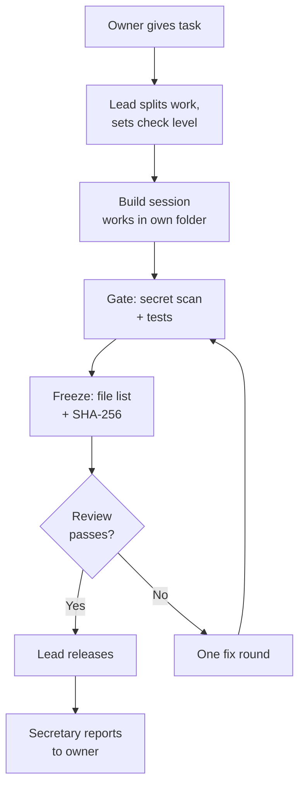
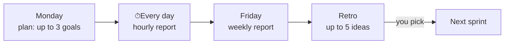

English · [Tiếng Việt](README_VN.md)

# Workflow Skill Bundle

Lets several Claude Code sessions work on one project like a real team: a lead splits the work, members do it, a reviewer checks it, and you approve the risky steps.

Version 1.1.2 · License: Apache License 2.0 · Repository: https://github.com/mquan1192/ai-skills

This bundle is one of three independent bundles in this repository ([overview](../README.md)). You can install it on its own.

---

## Part 1. In short (for everyone)

### Think of it as a small project team

You are the **project owner**. Each Claude Code session plays one role, like people in a team:

| Role | Does what |
|---|---|
| 🧭 **Lead** | Receives your tasks, splits and assigns them, decides the order |
| 🛠️ **Build sessions** | Do the work, each only in its own folders |
| 🔍 **Review session** | Checks the finished work before it is released |
| 📋 **Secretary** | Collects questions and results, sends you a short report every hour |
| 📝 **Docs session** | The only one allowed to edit shared files |

### Before and after

| Without the bundle | With the bundle |
|---|---|
| Several AI sessions in one folder overwrite each other's files | Each role writes only in its own folders |
| Nobody knows who is doing what | The lead keeps one board with every task, owner and status |
| Work ships without anyone checking it | Code goes through automatic checks and a review session first |
| The AI deletes files or changes settings on its own | Deletions, permissions, settings, extra cost and anything sent outside wait for you |

### Who decides what

| Kind of step | Who decides |
|---|---|
| Routine work inside one's own folder | Runs on its own |
| Order, assignment, scope | 🧭 Lead |
| Delete, permissions, settings, extra cost, anything sent outside the project | 🧑 You |

### How you use it

1. Give tasks to the **lead** session, in plain words.
2. Answer the approval questions it brings you.
3. Read the hourly report from the secretary, and the weekly report on Friday.


### Get started in 3 steps

1. Download `Workflow-Skill-Bundle_v1.1.2_20261128.zip` from the [Releases](https://github.com/mquan1192/ai-skills/releases) page and unzip it **outside** your project.
2. Open Claude Code in your project and say: *"Read `DOC-TRUOC.md` in the bundle folder and install this bundle."*
3. Claude shows you the plan first and installs only after you agree.

You need Claude Code, Python 3.8+ and PowerShell 7.

---

## Part 2. Details

### Building blocks

The bundle adds four kinds of plain files to your project: skills, rule files, scripts and hooks.

| Part | What it is |
|---|---|
| **Claude Code** | Anthropic's AI assistant that works inside a project folder; it reads and writes files and runs commands within the permissions you set |
| **Skills** (3) | Instruction folders Claude loads when needed: `q-wf-team` (rules for every session), `q-wf-lead` (the lead's board, inbox, sprint and retrospective), `q-wf-card` (the step-by-step change flow) |
| **Rule files** | `CLAUDE.md` and `AGENTS.md`, read by the AI at the start of every session. The bundle adds a short section that points to the skills |
| **Scripts** (10) | Small PowerShell 7 programs that do the bookkeeping: create tickets (hand-over records between sessions), record the file list of a change, run the checks, write the release record |
| **Hooks** (2) | Small programs Claude Code runs at fixed moments. `turnlog.py` writes one time line per turn (no message text). `ctxwatch.py` warns when a conversation passes a size limit (250,000 tokens by default; a token is roughly a short word) |
| **Configuration** | One file holds everything project-specific: folders, session names, approval wording, thresholds. The bundle contains no data from any project |

### Code changes: the card flow

A **card** is one change request with its own folder. The flow needs no git: a **manifest** takes the place of a commit. It lists every changed file with its SHA-256 fingerprint; if one byte changes, the fingerprint changes, so the reviewer knows it checks exactly the frozen version.



| Step | Meaning |
|---|---|
| Gate | An automatic check by a script: scans for secrets (prints only file, line and rule, never the value) and runs the tests |
| Freeze | Records the file list with fingerprints so the version under review cannot change unnoticed |
| Review | A separate session checks the frozen version; at most one fix round |
| Release | Marks the change as released inside the project. Nothing is pushed, merged or deployed |

### The one-week sprint



The lead plans on Monday and you answer once. The secretary reports every hour, only when there is something new. On Friday the lead writes a one-page weekly report and a retrospective (a short look back) with up to five improvement ideas; you choose which to adopt, at most one process change per week.

### What is inside

| Part | Content |
|---|---|
| `DOC-TRUOC.md` | "Read first": what the bundle contains and the install steps for the AI |
| `skills/` | The three skills `q-wf-team`, `q-wf-lead`, `q-wf-card` |
| `AGENTS.md` | The card and ticket rules for code and script work |
| `scripts/` | Ten PowerShell 7 scripts with tests |
| `hooks/` | `turnlog.py`, `ctxwatch.py` |
| `templates/` | Starter files: roles, names, rule history, card template, lead board, inbox, sprint and retrospective templates |
| `config/` | The example configuration file |
| `docs/` | Process diagrams and a full example on a sample project |
| `install.py` | Installer and uninstaller |

### Requirements

- Claude Code (command line or desktop app).
- Python 3.8 or later, standard library only (for the installer and hooks).
- Python command: the installer finds it on your machine. It tries the command already used in the project, then `python`, `python3` and `py -3`, and writes the first one that really runs into the hook commands. On macOS and Linux, start the installer with `python3`. To choose the command yourself, add `--python <command or path>`.
- Recommended version: a release in the bug-fix phase on python.org (3.14 and 3.15 as of 2026-11-28). Python 3.10 reached end of life in October 2026.
- PowerShell 7 (`pwsh`) for the scripts. Windows PowerShell 5.1 is refused.
- Hooks are optional.

### Install

1. Unzip the bundle **outside** your project folder. The installer stops if the bundle sits inside the project.
2. Ask Claude Code: "Read `DOC-TRUOC.md` in the bundle folder and install this bundle."
3. Claude first runs a **dry run**, which only prints what it would write, skip, and what conflicts it found.
4. After you agree, Claude runs the real install (`--apply`).

The installer never overwrites an existing `CLAUDE.md`, `AGENTS.md` or `.claude/settings.json`. It puts the parts to merge in `.workflow/merge/` and Claude asks you before merging each one. Before writing, it checks the SHA-256 fingerprint of every bundle file against `MANIFEST.json` and stops if the bundle was changed.

### Uninstall

```powershell
python install.py --target <project folder> --uninstall           # dry run (macOS / Linux: python3)
python install.py --target <project folder> --uninstall --apply   # remove
```

It removes only files that are still byte-for-byte as installed. Files you changed (board, cards, configuration) and backups in `.workflow/backup/` stay. Details: `README_VN.md` section 6.

### Safety

- No network: the installer, scripts and hooks never connect to the internet and never install Python packages.
- Writes only inside the target project folder; does not follow links that point outside it.
- The scripts never push, merge or deploy.
- The hooks never record message text. If a hook script is deleted, its command exits quietly and does not block your work.
- Details: `SECURITY.md`.

### Language of the documentation

This README is in English. All other documents in the bundle (skills, `DOC-TRUOC.md`, `README_VN.md`, `SECURITY.md`, templates) are in Vietnamese. Claude reads them in any case and answers in the language you write in.

## License

Apache License 2.0. The full text is in the `LICENSE` file.

Copyright 2026 Nguyễn Minh Quân (https://github.com/mquan1192)
