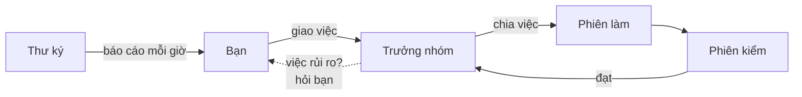
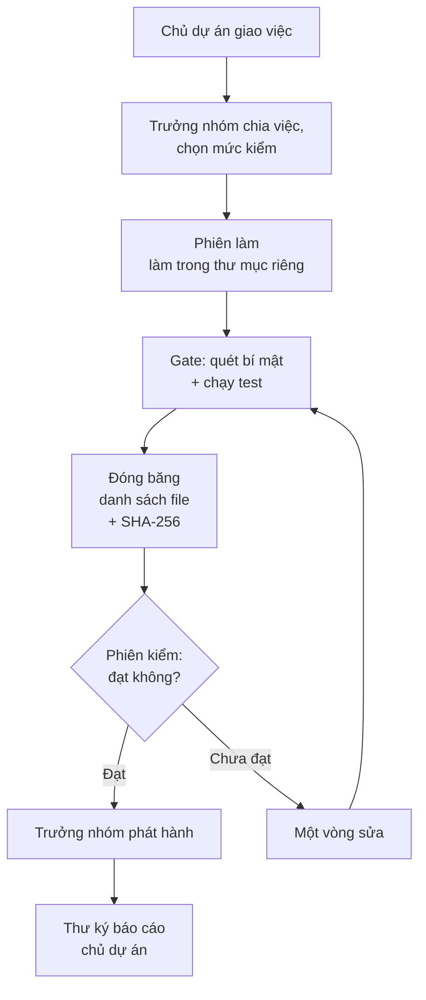
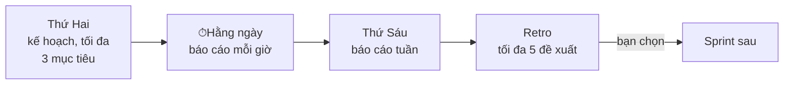

[English](README.md) · Tiếng Việt

# Gói quy trình nhóm (workflow skill bundle) v1.1.1: hướng dẫn

Giúp nhiều phiên Claude Code làm việc trên một dự án như một nhóm thật: trưởng nhóm chia việc, thành viên làm, người kiểm soát lại, còn bạn duyệt các bước có rủi ro.

Bản 1.1.1 · Giấy phép: Apache License 2.0 (file `LICENSE`; Copyright 2026 Nguyễn Minh Quân (https://github.com/mquan1192)) · Kho mã: https://github.com/mquan1192/ai-skills

Gói này là một trong ba gói độc lập của repo ([tổng quan](../README_VN.md)); cài riêng được.

---

## Phần 1. Sơ lược (ai cũng đọc được)

### Hình dung: một nhóm dự án nhỏ

Bạn là **chủ dự án**. Mỗi phiên Claude Code đóng một vai, giống người trong nhóm:

| Vai | Làm gì |
|---|---|
| 🧭 **Trưởng nhóm** | Nhận việc từ bạn, chia và giao việc, quyết thứ tự |
| 🛠️ **Phiên làm** | Làm việc được giao, mỗi phiên chỉ ghi trong thư mục của mình |
| 🔍 **Phiên kiểm** | Soát sản phẩm trước khi phát hành |
| 📋 **Thư ký** | Gom câu hỏi và kết quả, gửi bạn báo cáo ngắn mỗi giờ |
| 📝 **Phiên tài liệu** | Phiên duy nhất được sửa file dùng chung |

### Trước và sau khi cài

| Chưa có gói | Có gói |
|---|---|
| Nhiều phiên AI cùng thư mục, ghi đè file của nhau | Mỗi vai chỉ ghi trong thư mục của mình |
| Không rõ ai đang làm việc gì | Trưởng nhóm giữ một bảng việc: việc, người làm, trạng thái |
| Sản phẩm giao đi mà chưa ai kiểm | Code qua bước kiểm tự động và phiên kiểm trước |
| AI tự xóa file, tự đổi cấu hình | Xóa, quyền, cấu hình, chi phí thêm, gửi ra ngoài: chờ bạn duyệt |

### Ai quyết việc gì

| Loại việc | Ai quyết |
|---|---|
| Việc thường trong thư mục của mình | Tự chạy |
| Thứ tự, giao việc, phạm vi | 🧭 Trưởng nhóm |
| Xóa, quyền, cấu hình, chi phí thêm, mọi thứ gửi ra ngoài dự án | 🧑 Bạn |

### Bạn dùng thế nào

1. Giao việc cho phiên **trưởng nhóm** bằng lời thường.
2. Trả lời các câu hỏi duyệt mà trưởng nhóm đưa lên.
3. Đọc báo cáo mỗi giờ của thư ký, và báo cáo tuần vào thứ Sáu.



### Bắt đầu trong 3 bước

1. Tải `Workflow-Skill-Bundle_v1.1.1_20261125.zip` ở trang [Releases](https://github.com/mquan1192/ai-skills/releases), giải nén ra **ngoài** dự án.
2. Mở Claude Code trong dự án và nói: *"Đọc `DOC-TRUOC.md` trong thư mục gói và cài gói này."*
3. Claude cho xem kế hoạch trước, chỉ cài khi bạn đồng ý.

Máy cần có Claude Code, Python 3.8+ và PowerShell 7.

---

## Phần 2. Chi tiết

### Các thành phần

Gói thêm bốn loại file thường vào thư mục dự án: skill, file quy tắc, script, hook.

| Thành phần | Là gì |
|---|---|
| **Claude Code** | Trợ lý AI của Anthropic, làm việc trong thư mục dự án; đọc, ghi file và chạy lệnh trong phạm vi quyền được cấp |
| **Skill** (3) | Thư mục hướng dẫn Claude nạp khi cần: `q-wf-team` (quy tắc cho mọi phiên), `q-wf-lead` (board, INBOX, sprint, retro của trưởng nhóm), `q-wf-card` (luồng thay đổi từng bước) |
| **File quy tắc** | `CLAUDE.md` và `AGENTS.md`, AI đọc khi bắt đầu mỗi phiên. Gói thêm một đoạn ngắn trỏ tới các skill |
| **Script** (10) | Chương trình PowerShell 7 nhỏ làm phần sổ sách: tạo vé (biên bản bàn giao giữa các phiên), ghi danh sách file của một thay đổi, chạy bước kiểm, ghi biên bản phát hành |
| **Hook** (2) | Chương trình nhỏ Claude Code tự chạy vào thời điểm cố định. `turnlog.py` ghi một dòng thời gian mỗi lượt (không ghi nội dung tin). `ctxwatch.py` nhắc khi hội thoại vượt ngưỡng (mặc định 250 nghìn token; token là đơn vị đo độ dài văn bản, khoảng một từ ngắn) |
| **Cấu hình** | Một file chứa mọi giá trị riêng của dự án: thư mục, tên phiên, câu duyệt, ngưỡng. Gói không chứa dữ liệu của dự án nào |

### Thay đổi code: luồng card

Mỗi **card** là một yêu cầu thay đổi có thư mục riêng. Luồng này không cần git: **manifest** thay cho commit. Manifest liệt kê mọi file thay đổi kèm dấu vân tay SHA-256; đổi một byte thì dấu vân tay đổi, nên phiên kiểm biết chắc mình kiểm đúng bản đã đóng băng.



| Bước | Ý nghĩa |
|---|---|
| Gate | Bước kiểm tự động bằng script: quét bí mật (chỉ in file, dòng, quy tắc, không in giá trị) và chạy test |
| Đóng băng | Ghi danh sách file kèm dấu vân tay để bản đang kiểm không thể đổi mà không ai biết |
| Kiểm | Một phiên riêng kiểm bản đã đóng băng; tối đa một vòng sửa |
| Phát hành | Đánh dấu thay đổi đã phát hành trong dự án. Không push, không merge, không deploy |

### Sprint 1 tuần



Trưởng nhóm lập kế hoạch thứ Hai, bạn trả lời một lần. Thư ký báo cáo mỗi giờ, chỉ khi có điều mới. Thứ Sáu trưởng nhóm viết báo cáo tuần một trang và retro (nhìn lại việc cần cải tiến) với tối đa năm đề xuất; bạn chọn đề xuất nào áp dụng, tối đa một thay đổi quy trình mỗi tuần.

### Chỉ cài gói cần dùng

Gói này không cần hai gói kia của repo: gói có `install.py` riêng. Để lấy riêng gói này: tải `Workflow-Skill-Bundle_v1.1.1_20261125.zip` ở trang Releases kèm file `.sha256` để kiểm file tải về, hoặc chép thư mục `workflow-skill-bundle/` từ repo. Nút "Download ZIP" trên trang repo tải cả ba gói.

### Tóm tắt yêu cầu, an toàn, gỡ

- **Yêu cầu**: Claude Code; Python 3.8+; PowerShell 7 cho script (mục 2).
- **An toàn**: không dùng mạng, chỉ ghi trong thư mục dự án, không push / merge / deploy, hook không ghi nội dung tin (`SECURITY.md`).
- **Gỡ**: `python install.py --target <thư mục dự án> --uninstall` (chạy thử), thêm `--apply` để gỡ thật; chỉ xóa file còn đúng như lúc cài (mục 6).
- **Ngôn ngữ**: tài liệu trong gói viết bằng tiếng Việt; Claude đọc được và trả lời theo ngôn ngữ người dùng.

Hướng dẫn cài, cấu hình, gỡ đầy đủ: các mục 1–7 bên dưới.

## 1. Mục đích

Đưa một quy trình làm việc nhóm cho nhiều phiên AI vào một dự án bất kỳ:
- vai trò và vùng ghi rõ ràng;
- mức duyệt và khối xác nhận cho chủ dự án;
- bàn giao, báo cáo ngắn;
- luồng card / vé có gate cho code và script;
- sprint 1 tuần, báo cáo gom mỗi giờ qua phiên thư ký;
- nhắc khi context của phiên quá lớn;
- quy tắc chung khi một guard / hook bảo vệ chặn việc;
- ghi thời gian từng bước.

Gói không chứa dữ liệu của dự án nào; mọi giá trị riêng nằm trong một file cấu hình.

## 2. Yêu cầu

| Thành phần | Yêu cầu |
|---|---|
| `install.py` | Python 3.8+ (chỉ thư viện chuẩn) |
| Script quy trình | PowerShell 7 (`pwsh`); Windows PowerShell 5.1 bị từ chối |
| Hook `turnlog.py`, `ctxwatch.py` | Python 3; công cụ AI có hỗ trợ hook kiểu Claude Code (không bắt buộc) |

## 3. Cài đặt

```powershell
python install.py --target <thư mục dự án>                 # 1. chạy thử: in kế hoạch, chưa ghi gì
python install.py --target <thư mục dự án> --apply         # 2. cài (hỏi lại; --yes chỉ dùng khi không có bàn phím và chủ dự án đã duyệt kế hoạch ở bước 1)
```

Tùy chọn:
- `--components skills,scripts,hooks,templates,docs`: chỉ cài một phần.
- `--owner-name "<cách gọi>"`, `--project-name <tên>`: điền sẵn vào config mới.
- `--adopt`: cho thay file đã có mà gói không nhận ra; file cũ được sao lưu trước.

Gói cài vào dự án đích (đường dẫn theo config):

| Từ gói | Tới dự án |
|---|---|
| `skills/q-wf-*` | `.claude/skills/q-wf-*` |
| `scripts/` | `paths.scripts` (mặc định `scripts/process/`) |
| `hooks/turnlog.py`, `hooks/ctxwatch.py` | `.claude/hooks/` (tệp `test_*.py` không được cài) |
| `config/workflow.config.example.json` | `.workflow/workflow.config.json` (chỉ khi chưa có) |
| `templates/` | `ROLES.md`, `NAMES.md`, `RULES-HISTORY.md` → `paths.process_docs`; khuôn card → `paths.cards`; board / INBOX / backlog → `paths.lead`; khuôn sprint / retro, hàng đợi vai trò → thư mục `_TEMPLATE/`; chính sách mặc định → `policy_file`. Khuôn chỉ tạo khi file chưa có |
| `DOC-TRUOC.md`, `README_VN.md`, `docs/` | `.workflow/` |

**Không bao giờ ghi đè** `CLAUDE.md`, `AGENTS.md`, `.claude/settings.json` đã có. Khi các file này đã tồn tại, installer làm 2 việc:
- in kế hoạch gộp;
- chép phần cần gộp vào `.workflow/merge/`: `CLAUDE-fragment.md`, `AGENTS.workflow.md`, `hooks.json`.

Khi chưa có, installer tạo mới từ gói. Khi tệp do lần cài trước tạo và chưa ai sửa, installer thay bằng bản mới (sao lưu bản cũ vào `.workflow/backup/`). `CLAUDE.md` có đoạn của gói bản cũ → không sửa, đoạn mới nằm trong `.workflow/merge/CLAUDE-fragment.md`.

**Nâng cấp từ 1.0**: chạy lại hai lệnh trên. Tệp của gói chưa ai sửa được cập nhật; tệp bạn đã sửa được giữ và báo là xung đột (dùng `--adopt` nếu muốn thay, có sao lưu). Thêm các khóa config mới ở mục 4 bằng tay.

Nếu bản 1.0 đã gộp tay khối hook vào `.claude/settings.json` (hoặc `settings.local.json`) của dự án, installer báo `lệnh hook dạng cũ (v1.0)`. Lệnh dạng cũ `python -I -S "${CLAUDE_PROJECT_DIR:-.}/.claude/hooks/turnlog.py"` thoát mã 2 khi thiếu script, nên có thể chặn mọi prompt. Thay toàn bộ các mục đó bằng khối trong `.workflow/merge/hooks.json` (dạng an toàn: thiếu script thì thoát 0), rồi khởi động lại phiên.

Mọi file đã cài được ghi trong `.workflow/install-record.json` (đường dẫn + SHA-256) để gỡ. Bản ghi được ghi lại sau từng file: nếu lần cài dừng giữa chừng (lỗi đĩa, quyền …), `--uninstall --apply` vẫn gỡ được phần đã ghi, kể cả file đang chép dở. Trước khi cài, installer kiểm SHA-256 mọi file của gói theo `MANIFEST.json`; gói bị sửa thì dừng.

## 4. Cấu hình

Sửa `.workflow/workflow.config.json` sau khi cài:

| Khóa | Ý nghĩa |
|---|---|
| `owner_name` | Cách gọi chủ dự án trong hướng dẫn (mặc định "chủ dự án") |
| `approval_name` | Chữ đứng đầu dòng duyệt / miễn review trong card (mặc định `owner`) |
| `policy_file` | File chính sách dữ liệu của dự án (mặc định bản chung `docs/process/POLICY.md`) |
| `paths.*` | Thư mục card, tài liệu quy trình, hàng đợi vai trò, trưởng nhóm, việc, script, nhật ký thời gian, thùng rác |
| `roles.*` | Tên phiên, ID phiên, model, vùng ghi của từng vai trò |
| `session_map_file` | File (trong dự án, không chia sẻ) ánh xạ vai trò → phiên để script in chuông gọi |
| `protected_paths`, `shared_paths`, `shared_paths_except` | Đường dẫn cần dòng duyệt / đường dẫn chỉ DOCS sửa |
| `stale`, `gate`, `steplog`, `sprint` | Ngưỡng vé đứng lâu, bản PowerShell cho gate (mặc định `ps7`), số ngày giữ nhật ký (mặc định 90), độ dài sprint |
| `report` | Phút báo cáo gom mỗi giờ, giờ bắt đầu / kết thúc, số mục tối đa cùng chờ chủ dự án (mới ở 1.1) |
| `docs.publish_windows` | Giờ phát hành thay đổi quy tắc theo đợt (mặc định 12:00, 17:30; mới ở 1.1) |
| `context` | Bật / tắt hook nhắc context, ngưỡng nhắc và ngưỡng "rất lớn" (mặc định 250 nghìn / 500 nghìn token; mới ở 1.1) |
| `limits` | Cỡ tối đa tệp đọc đầu việc và tệp quy tắc chính (10 KB / 25 KB; mới ở 1.1) |
| `guard_rule_enabled` | Bật / tắt quy tắc chung khi guard chặn (`AGENTS.md` § Guard; mới ở 1.1) |
| `writing_style_skill` | Tên skill văn phong dùng khi viết báo cáo / tài liệu, nếu dự án đã cài (mặc định `q-doc-edit`; mới ở 1.1) |

## 5. Dùng hằng ngày

- Mọi phiên: skill `q-wf-team`. Trưởng nhóm: `q-wf-lead`. Code / script: `AGENTS.md` + `q-wf-card`.
- Ví dụ đầy đủ một card trên dự án mẫu: `docs/vi-du-demo.md`. Sơ đồ: `docs/quy-trinh.md`.

## 6. Gỡ cài đặt

```powershell
python install.py --target <thư mục dự án> --uninstall           # chạy thử
python install.py --target <thư mục dự án> --uninstall --apply   # gỡ
```

Luật gỡ: chỉ xóa hoặc khôi phục file **còn đúng SHA-256 lúc cài**.

- File chưa ai sửa → xóa; nếu lúc cài đã thay file của bạn bằng `--adopt` thì chép lại bản gốc từ `.workflow/backup/`.
- File bạn đã sửa sau khi cài (board, card, config, skill …) → giữ nguyên, kể cả file từng được sao lưu bằng `--adopt`; lệnh gỡ in đường dẫn bản sao lưu để bạn tự so sánh.
- File bạn đã xóa sau khi cài → không khôi phục; lệnh gỡ in đường dẫn bản sao lưu.
- Bản sao lưu trong `.workflow/backup/` không bị xóa.
- Mục hook trong `.claude/settings.json`: file do gói tạo mà đã sửa → chỉ bỏ các mục hook `turnlog.py` / `ctxwatch.py`; khối hook bạn gộp tay vào `settings.json` của dự án → không sửa, chỉ cảnh báo; gỡ tay các mục `… turnlog.py …`, `… ctxwatch.py …` rồi khởi động lại phiên. Lệnh hook dạng an toàn (bản 1.1) thoát 0 khi thiếu script, nên mục sót lại không chặn prompt.
- Còn lệnh hook **dạng cũ (v1.0)** (`python -I -S "${CLAUDE_PROJECT_DIR:-.}/.claude/hooks/…"`, không có `runpy`) trong `.claude/settings.json` hoặc `settings.local.json` → lệnh gỡ báo `lệnh hook dạng cũ (v1.0)` và **giữ** script mà lệnh đó gọi (`.claude/hooks/turnlog.py` …) cùng một bản ghi nhỏ, vì thiếu script thì lệnh cũ thoát mã 2 và chặn mọi prompt. Xóa (hoặc thay bằng khối trong `hooks/hooks.json` của gói) các lệnh cũ, khởi động lại phiên, rồi chạy gỡ lại để xóa nốt script.
- `--components` không có `hooks` → không ghi mục hook nào.
- Nhật ký do hook ghi (`process-log/turns/…`) là dữ liệu của dự án → giữ lại sau khi gỡ; xóa tay nếu không cần.

## 7. Kiểm thử gói

```powershell
pwsh -File tests/install.Tests.ps1        # installer trên thư mục tạm
pwsh -File tests/ctxwatch.Tests.ps1       # hook nhắc context
pwsh -File scripts/tests/ticket.Tests.ps1 # (tương tự cho các test script khác)
```
