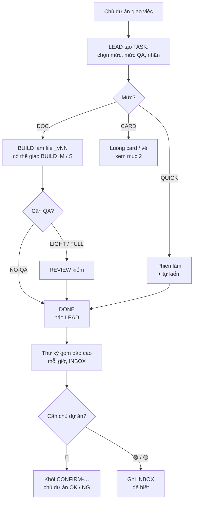
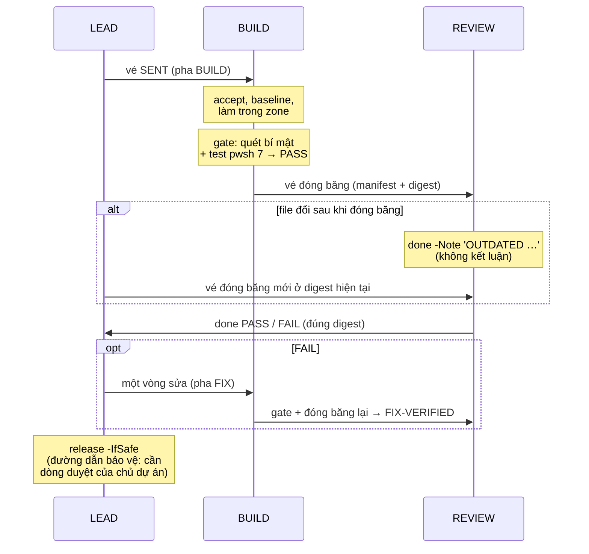

# Sơ đồ quy trình

## 1. Việc nhóm (mọi mức)

## 2. Card / vé (code, script, đường dẫn bảo vệ)

## 3. Sprint 1 tuần

| Ngày | Việc |
|---|---|
| Thứ Hai | Lập kế hoạch: ≤ 3 mục tiêu, danh sách TASK |
| Thứ Hai → Thứ Sáu | Làm việc; báo cáo gom mỗi giờ (chỉ khi có điều mới); INBOX |
| Thứ Sáu | Báo cáo tuần (`SPRINT-YYYY-Www.md`) + retro (`RETRO-YYYY-Www.md`) |
| Sau retro | Một card gom thay đổi quy tắc / skill, một dòng duyệt; tối đa một thay đổi quy trình mỗi tuần (trừ 🔴) |
