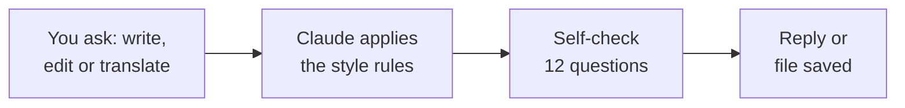
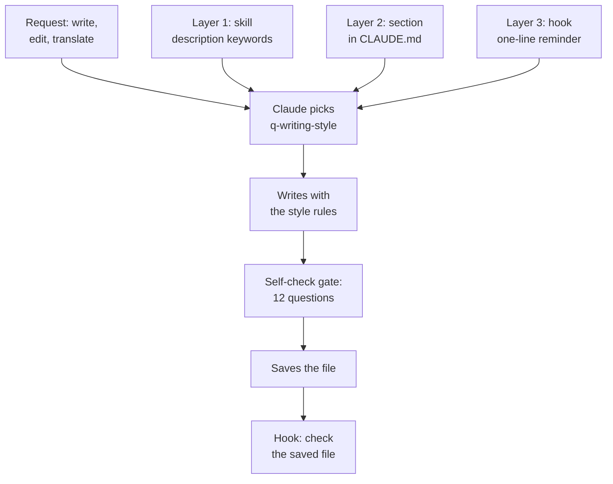

English · [Tiếng Việt](README_VN.md)

# Writing Style Bundle

Gives Claude Code one house style for everything it writes or translates (reports, emails, docs, articles, release notes, prompts) in Japanese, Vietnamese or English, and makes it check its own text before saving.

Version 1.2.1 · License: Apache License 2.0; some content is adapted from MIT-licensed works, see `THIRD-PARTY-NOTICES.md` · Repository: https://github.com/mquan1192/ai-skills

This bundle is one of three independent bundles in this repository ([overview](../README.md)). You can install it on its own.

---

## Part 1. In short (for everyone)

### Think of it as a style guide plus a proofreader

The bundle gives Claude a **style guide** (how to write), a **proofreader's checklist** (what to check before handing the text in) and **translator's notes** for Japanese, Vietnamese and English. The rule of thumb is simple: **correct first, then complete, clear, short, natural**. If short and correct conflict, correct wins.

### Before and after

| Without the bundle | With the bundle |
|---|---|
| AI text is long, vague and full of stock phrases | Short sentences, the point first, typical "AI tells" removed |
| AI may add claims the source does not support, or drop a condition | Numbers, dates, names, versions and conditions stay exactly as in the source |
| A proposal can quietly become a "decision" | A proposal stays a proposal; open points stay open |
| Translations lose politeness levels or certainty ("planned" becomes "decided") | Honorifics, forms of address and certainty are kept; the translation is self-checked |
| Each person and session writes differently | One style across people, sessions and the three languages; it can also follow your own voice |

### How you use it

**Just ask as usual**: "write the weekly report", "translate this email into Japanese", "make this sound less like AI". Claude is reminded to apply the style. To call it directly, use `/q-writing-style <mode> <text or file>`:

| Mode | Does what |
|---|---|
| `polish` | Fixes wording only; keeps the structure |
| `restructure` | Reorders the content into a clearer layout |
| `summarize` | Makes a short version that keeps the key facts |
| `rewrite` | Writes the text again in the house style |
| `translate` | Translates a sentence, an email or a whole file between JA / VI / EN |
| `humanize` | Removes typical signs of AI-written text |
| `plain` | Rewrites in plain, simple language |
| `voice` | Writes like a sample text or your saved voice profile |
| `check` | Only lists problems; changes nothing |



### Get started in 3 steps

1. Download `Writing-Style-Bundle_v1.2.1_20261128.zip` from the [Releases](https://github.com/mquan1192/ai-skills/releases) page and unzip it **outside** your project.
2. Open Claude Code in your project and say: *"Read `DOC-TRUOC.md` in the bundle folder and install this bundle."*
3. Claude shows you the plan first and installs only after you agree.

You need Claude Code and Python 3.8+.

---

## Part 2. Details

### Building blocks

| Part | What it is |
|---|---|
| **Claude Code** | Anthropic's AI assistant that works inside a project folder; it reads and writes files and runs commands within the permissions you set |
| **Skill** `q-writing-style` | An instruction folder Claude loads when needed: style guide, layouts for 18 document types, references for AI tells, plain language, Vietnamese register, translation and voice, before-and-after examples |
| **Rule file** | `CLAUDE.md`, read at the start of every session. The bundle adds a short section: for a report or document, use the document-type skill first, then `q-writing-style`, then self-check before saving |
| **Hook** `stylewatch.py` | A small program Claude Code runs at fixed moments. It adds a one-line reminder when your request contains a keyword such as "report", "email", "translate", "slide", "dịch", "翻訳", "blog" or "humanize", and after Claude saves a document in an output folder. It never blocks anything and never stores your text |
| **Lint script** (optional) | `scripts/lint_text.py` flags non-NFC text, mixed tone marks, em dashes, AI phrases and bold-label lists |
| **Configuration** | Turn the hook on or off, set keywords, file types, output folders, a voice profile, and link your project's own writing rules and glossary, which take priority over the skill |

### Three layers make Claude pick the skill



Any one layer can bring Claude to the skill; three layers make it far less likely to be skipped. There are two checks: the self-check before saving, and the hook's reminder after saving.

### What the skill covers

- **Facts kept**: numbers, dates, names, versions, conditions and open points stay as they are. A proposal never becomes a decision.
- **AI tells removed**: 26 patterns grouped by kind and strength (staging, rhythm by rule, inflation, decorative formatting, chatbot residue, writing for the wrong reader), with a list of what must *not* be changed.
- **Vietnamese done right**: form of address by document type and channel, English technical terms kept by formality, machine-translation calques removed, NFC Unicode, one tone-mark style.
- **Japanese–Vietnamese–English translation**: certainty kept (予定 / 検討中 / 見込み), honorifics and address mapped by relationship, 万 / 億 conversions checked, self-check against the target language.
- **Your own voice**: write like a sample; build a five-part voice profile (style only, never content) and reuse it through the `voice_profile` key.
- **A report frame for Vietnamese**: neutral, data-based tone; purpose, method, results with a short conclusion after each table, conditions, next steps.
- **Principles for every language**: rigorous reasoning, a named actor, one term per concept, one topic per paragraph, no dramatisation, no repetition, register by document type, the conventions of an existing file kept.
- **Empty-word lists per language**: `ng-vocab-vi.md`, `ng-vocab-ja.md`, `ng-vocab-en.md`, each with a self-check table; the skill reads only the list of the language it is writing.
- **Project rules first**: your project's writing rules and glossary, linked in the configuration, override the skill. The bundle contains no data from any project.

### What is inside

| Part | Content |
|---|---|
| `DOC-TRUOC.md` | "Read first": what the bundle contains and the install steps for the AI |
| `skills/q-writing-style/` | The skill: `SKILL.md`, style guide, empty-word lists (`references/ng-vocab-*.md`), document layouts, AI tells, plain language, Vietnamese register, translation, voice profile, examples, `scripts/lint_text.py`, `NOTICES.md`, tests |
| `templates/CLAUDE-fragment.md` | The section for `CLAUDE.md` |
| `hooks/` | `stylewatch.py` and its hook settings |
| `config/` | The example configuration file |
| `tools/` | `scan_terms.py`: finds project-specific words before you share files |
| `install.py` | Installer and uninstaller |
| `THIRD-PARTY-NOTICES.md` | Copyright and MIT License notices of the adapted third-party works |

### Requirements

- Claude Code (command line or desktop app).
- Python 3.8 or later, standard library only (for the installer and hook).
- Python command: the installer finds it on your machine. It tries the command already used in the project, then `python`, `python3` and `py -3`, and writes the first one that really runs into the hook commands. On macOS and Linux, start the installer with `python3`. To choose the command yourself, add `--python <command or path>`.
- Recommended version: a release in the bug-fix phase on python.org (3.14 and 3.15 as of 2026-11-28). Python 3.10 reached end of life in October 2026.
- PowerShell 7 (`pwsh`) only to run the bundle's tests.
- The hook is optional.

### Install

1. Unzip the bundle **outside** your project folder. The installer stops if the bundle sits inside the project.
2. Ask Claude Code: "Read `DOC-TRUOC.md` in the bundle folder and install this bundle."
3. Claude first runs a **dry run**, which only prints what it would write, skip, and what conflicts it found.
4. After you agree, Claude runs the real install (`--apply`).

If your project has no `CLAUDE.md` or `.claude/settings.json` yet, the installer creates them and the style works at once. Existing files are never overwritten: the parts to merge go to `.writing-style/merge/` and Claude asks you before merging each one. If the project already has its own `q-writing-style` skill, the installer keeps it and reports the difference. When you upgrade from a version before 1.2.0, the installer removes the old skill files it installed and nobody changed (with a backup), and keeps and reports any you changed. Before writing, it checks the SHA-256 fingerprint of every bundle file against `MANIFEST.json` and stops if the bundle was changed.

### Uninstall

```powershell
python install.py --target <project folder> --uninstall           # dry run (macOS / Linux: python3)
python install.py --target <project folder> --uninstall --apply   # remove
```

It removes only files that are still byte-for-byte as installed. Files you changed (for example the configuration) and backups in `.writing-style/backup/` stay. Details: `README_VN.md` section 6.

### Safety

- No network: the installer and hook never connect to the internet and never install Python packages.
- The skill edits text in place. It does not send your text to outside services and does not search the internet when you only ask for an edit.
- Writes only inside the target project folder; does not follow links that point outside it.
- The hook reads your request only to look for keywords. It writes no file and never repeats your text.
- Details: `SECURITY.md`.

### Language of the documentation

This README is in English. All other documents in the bundle (the skill, `DOC-TRUOC.md`, `README_VN.md`, `SECURITY.md`) are in Vietnamese, except the three word lists `references/ng-vocab-*.md`, `THIRD-PARTY-NOTICES.md` and the skill's `NOTICES.md`, which are in English. Claude reads them in any case, answers in the language you write in, and applies the English and Japanese style rules as well.

## License

Apache License 2.0. The full text is in the `LICENSE` file. Parts of the skill are adapted from works under the MIT License (`japanese-tech-writing`, `stop-ai-slop-jp`, `humanizer`, `SimpleEnglish`, `vietnamese-language-skill`); their notices are in `THIRD-PARTY-NOTICES.md` and travel with the skill in `skills/q-writing-style/NOTICES.md`. Ideas only (no text) are taken from `writing-dna-skill`, whose PolyForm Noncommercial license does not allow its text to be included here.

Copyright 2026 Nguyễn Minh Quân (https://github.com/mquan1192)
