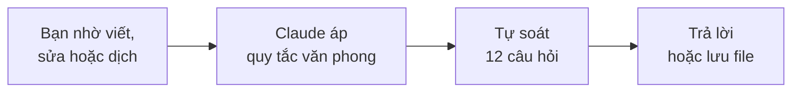
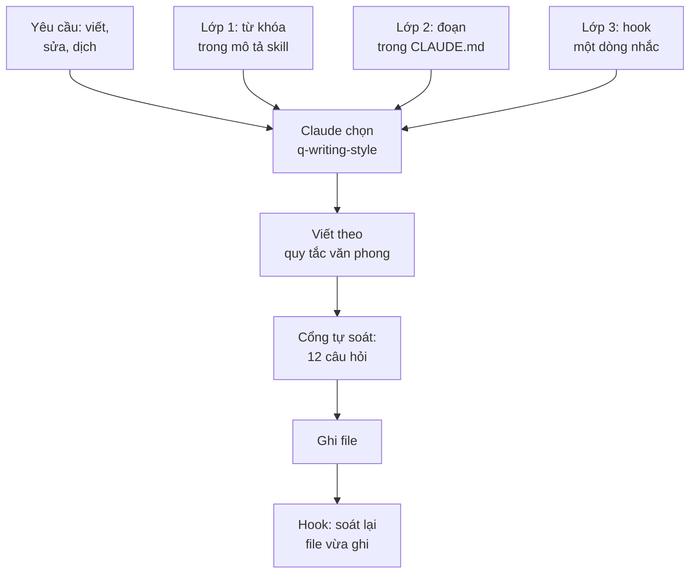

[English](README.md) · Tiếng Việt

# Gói văn phong (writing style bundle) v1.2.0: hướng dẫn

Cho Claude Code một văn phong chung cho mọi thứ nó viết hoặc dịch (báo cáo, mail, tài liệu, bài viết, release note, prompt) bằng tiếng Nhật, Việt hoặc Anh, và bắt Claude tự soát bài trước khi lưu file.

Bản 1.2.0 · Giấy phép: Apache License 2.0 (file `LICENSE`; Copyright 2026 Nguyễn Minh Quân (https://github.com/mquan1192)); một phần nội dung phỏng theo tác phẩm MIT, thông báo bản quyền ở `THIRD-PARTY-NOTICES.md` · Kho mã: https://github.com/mquan1192/ai-skills

Gói này là một trong ba gói độc lập của repo ([tổng quan](../README_VN.md)); cài riêng được.

---

## Phần 1. Sơ lược (ai cũng đọc được)

### Hình dung: sổ tay văn phong kèm người soát bài

Gói đưa cho Claude một **sổ tay văn phong** (viết thế nào), một **danh sách soát bài** (kiểm gì trước khi nộp) và **ghi chú của người dịch** cho tiếng Nhật, Việt, Anh. Nguyên tắc rất ngắn: **Đúng trước, rồi Đủ, Rõ, Gọn, Tự nhiên**. Gọn mà sai thì chọn đúng.

### Trước và sau khi cài

| Chưa có gói | Có gói |
|---|---|
| Văn AI dài, chung chung, nhiều câu sáo | Câu ngắn, ý chính lên trước, bỏ các dấu vết "văn AI" |
| AI có thể thêm ý nguồn không có, hoặc bỏ mất một điều kiện | Số, ngày, tên, phiên bản, điều kiện giữ đúng như nguồn |
| Đề xuất lặng lẽ thành "quyết định" | Đề xuất vẫn là đề xuất; điểm còn mở vẫn ghi là còn mở |
| Bản dịch mất kính ngữ hoặc đổi mức chắc chắn ("dự kiến" thành "đã chốt") | Giữ kính ngữ, xưng hô và mức chắc chắn; bản dịch được tự soát |
| Mỗi người, mỗi phiên viết một kiểu | Một văn phong cho mọi người, mọi phiên, cả ba ngôn ngữ; viết theo giọng riêng của bạn được |

### Bạn dùng thế nào

**Cứ nhờ như bình thường**: "viết báo cáo tuần", "dịch mail này sang tiếng Nhật", "sửa cho bớt giọng AI". Claude được nhắc dùng văn phong. Muốn gọi thẳng: `/q-writing-style <chế độ> <văn bản hoặc file>`.

| Chế độ | Làm gì |
|---|---|
| `polish` | Chỉ sửa câu chữ, giữ bố cục |
| `restructure` | Sắp xếp lại nội dung cho rõ |
| `summarize` | Tóm tắt, giữ đủ ý và số liệu chính |
| `rewrite` | Viết lại theo văn phong chung |
| `translate` | Dịch câu, thư hoặc cả file giữa JA / VI / EN |
| `humanize` | Bỏ dấu vết văn AI |
| `plain` | Viết lại cho đơn giản, dễ hiểu |
| `voice` | Viết theo văn mẫu hoặc hồ sơ giọng văn đã lưu |
| `check` | Chỉ liệt kê lỗi, không sửa |



### Bắt đầu trong 3 bước

1. Tải `Writing-Style-Bundle_v1.2.0_20261126.zip` ở trang [Releases](https://github.com/mquan1192/ai-skills/releases), giải nén ra **ngoài** dự án.
2. Mở Claude Code trong dự án và nói: *"Đọc `DOC-TRUOC.md` trong thư mục gói và cài gói này."*
3. Claude cho xem kế hoạch trước, chỉ cài khi bạn đồng ý.

Máy cần có Claude Code và Python 3.8+.

---

## Phần 2. Chi tiết

### Các thành phần

| Thành phần | Là gì |
|---|---|
| **Claude Code** | Trợ lý AI của Anthropic, làm việc trong thư mục dự án; đọc, ghi file và chạy lệnh trong phạm vi quyền được cấp |
| **Skill** `q-writing-style` | Thư mục hướng dẫn Claude nạp khi cần: hướng dẫn văn phong, bố cục cho 18 loại văn bản, tài liệu về dấu vết văn AI, viết đơn giản, xưng hô tiếng Việt, dịch, giọng văn, ví dụ trước / sau |
| **File quy tắc** | `CLAUDE.md`, AI đọc khi bắt đầu mỗi phiên. Gói thêm một đoạn ngắn: viết báo cáo / tài liệu thì dùng skill loại tài liệu trước, rồi `q-writing-style`, rồi tự soát trước khi ghi file |
| **Hook** `stylewatch.py` | Chương trình nhỏ Claude Code tự chạy vào thời điểm cố định. Thêm một dòng nhắc khi yêu cầu có từ khóa như "báo cáo", "mail", "dịch", "slide", "翻訳", "bài viết", "humanize", và sau khi Claude ghi file tài liệu trong thư mục đầu ra. Không chặn việc gì, không lưu nội dung bạn gõ |
| **Script kiểm** (tùy chọn) | `scripts/lint_text.py` báo NFC, trộn kiểu dấu thanh, gạch ngang dài, cụm văn AI, danh sách nhãn đậm |
| **Cấu hình** | Bật / tắt hook, đặt từ khóa, loại file, thư mục đầu ra, hồ sơ giọng văn, và trỏ tới quy tắc viết, glossary riêng của dự án (được ưu tiên hơn skill) |

### Ba lớp giúp Claude chọn đúng skill



Chỉ cần một lớp là Claude tìm tới skill; có ba lớp thì rất khó bị bỏ sót. Có hai bước kiểm: tự soát trước khi ghi file, và hook nhắc soát lại sau khi ghi.

### Skill bao gồm những gì

- **Giữ sự thật**: số, ngày, tên, phiên bản, điều kiện, điểm còn mở giữ nguyên. Đề xuất không bao giờ thành quyết định.
- **Bỏ dấu vết văn AI**: 26 dấu hiệu theo nhóm và độ mạnh (dàn dựng, nhịp theo luật, thổi phồng, trình bày trang trí, lời chatbot, sai người đọc), kèm danh sách những gì *không* được sửa.
- **Tiếng Việt đúng mực**: xưng hô theo loại văn bản và kênh (tài liệu không "bạn", B2B "anh/chị" – "em/tôi"), giữ thuật ngữ tiếng Anh theo mức trang trọng, bỏ từ dịch máy ("cam kết" cho commit), Unicode NFC, một kiểu đặt dấu thanh.
- **Dịch Nhật – Việt – Anh**: giữ mức chắc chắn (予定 / 検討中 / 見込み), kính ngữ và xưng hô theo quan hệ, đổi 万 / 億 an toàn, tự soát theo ngôn ngữ đích.
- **Giọng văn riêng**: viết theo mẫu; lập hồ sơ giọng văn 5 phần (chỉ ghi cách viết, không ghi nội dung) và dùng lại qua khóa `voice_profile`.
- **Khung báo cáo tiếng Việt**: giọng trung tính, dựa số liệu; mục đích → phương pháp → kết quả (sau mỗi bảng có kết luận ngắn) → điều kiện → định hướng.
- **Nguyên tắc chung cho mọi ngôn ngữ**: lập luận chặt, chủ thể rõ, một thuật ngữ một từ, một đoạn một chủ đề, không cường điệu, không lặp, văn thể theo loại tài liệu, giữ quy ước của file có sẵn.
- **Danh sách từ rỗng theo ngôn ngữ**: `ng-vocab-vi.md`, `ng-vocab-ja.md`, `ng-vocab-en.md`, mỗi file có bảng tự soát; skill chỉ đọc file của ngôn ngữ đang viết.
- **Quy tắc dự án trước**: quy tắc viết và glossary riêng của dự án (khai trong cấu hình) được ưu tiên hơn skill. Gói không chứa dữ liệu của dự án nào.

### Chỉ cài gói cần dùng

Gói này không cần hai gói kia của repo: gói có `install.py` riêng. Để lấy riêng gói này: tải `Writing-Style-Bundle_v1.2.0_20261126.zip` ở trang Releases kèm file `.sha256` để kiểm file tải về, hoặc chép thư mục `writing-style-bundle/` từ repo. Nút "Download ZIP" trên trang repo tải cả ba gói.

### Tóm tắt yêu cầu, an toàn, gỡ

- **Yêu cầu**: Claude Code; Python 3.8+; PowerShell 7 chỉ để chạy test của gói (mục 2).
- **An toàn**: không dùng mạng, chỉ ghi trong thư mục dự án; skill sửa văn bản tại chỗ, không gửi văn bản ra dịch vụ bên ngoài (`SECURITY.md`).
- **Gỡ**: `python install.py --target <thư mục dự án> --uninstall` (chạy thử), thêm `--apply` để gỡ thật; chỉ xóa file còn đúng như lúc cài (mục 6).
- **Ngôn ngữ**: tài liệu trong gói viết bằng tiếng Việt, trừ 3 danh sách từ `references/ng-vocab-*.md`, `THIRD-PARTY-NOTICES.md` và `NOTICES.md` của skill viết bằng EN; Claude đọc được, trả lời theo ngôn ngữ người dùng và áp dụng cả quy tắc cho văn bản EN, JA.

Hướng dẫn cài, cấu hình, gỡ đầy đủ: các mục 1–7 bên dưới.

## 1. Mục đích

Đưa một văn phong thống nhất cho mọi văn bản công việc vào một dự án bất kỳ:
- skill `q-writing-style` (VI / JA / EN): viết, sửa, rút gọn, sắp xếp lại, dịch, bỏ giọng AI cho mọi loại văn bản, giữ đúng số liệu và ý;
- khung báo cáo tiếng Việt: giọng trung tính, dựa số liệu, mục đích → phương pháp → kết quả ("Nhận xét:" / "Kết luận:") → điều kiện → "Định hướng:";
- tự áp dụng khi viết báo cáo nhờ 3 lớp: mô tả skill có đủ từ khóa, đoạn chèn `CLAUDE.md`, hook nhắc.

Gói không chứa dữ liệu của dự án nào; quy tắc và glossary riêng của dự án được trỏ tới bằng cấu hình.

## 2. Yêu cầu

| Thành phần | Yêu cầu |
|---|---|
| `install.py` | Python 3.8+ (chỉ thư viện chuẩn) |
| Hook `stylewatch.py` | Python 3; công cụ AI có hỗ trợ hook kiểu Claude Code (không bắt buộc) |
| Test | PowerShell 7 (`pwsh`) cho các tệp `*.Tests.ps1`; Python 3 cho test Python |

## 3. Cài đặt

Giải nén gói ra **ngoài** thư mục dự án (gói nằm trong dự án đích thì installer dừng), rồi chạy:

```powershell
python install.py --target <thư mục dự án>                 # 1. chạy thử: in kế hoạch, chưa ghi gì
python install.py --target <thư mục dự án> --apply         # 2. cài (hỏi lại; thêm --yes khi không có bàn phím)
```

Tùy chọn: `--components skills,hooks,docs` (chỉ cài một phần; không có `hooks` thì không ghi mục hook nào vào `settings.json` hay `merge/`) · `--adopt` (cho thay file đã có mà gói không nhận ra, sau khi sao lưu).

| Từ gói | Tới dự án |
|---|---|
| `skills/q-writing-style/` | `.claude/skills/q-writing-style/` |
| `hooks/stylewatch.py` | `.claude/hooks/stylewatch.py` (tệp `test_*.py` không được cài) |
| `config/style.config.example.json` | `.writing-style/style.config.json` (chỉ khi chưa có) |
| `DOC-TRUOC.md`, `README_VN.md`, `CHANGELOG.md`, `SECURITY.md` | `.writing-style/` |
| `templates/CLAUDE-fragment.md` | `CLAUDE.md` khi chưa có; đã có → `.writing-style/merge/CLAUDE-fragment.md` |
| `hooks/hooks.json` | `.claude/settings.json` khi chưa có; đã có → `.writing-style/merge/hooks.json` |

**Không bao giờ ghi đè** `CLAUDE.md` và `.claude/settings.json` đã có: installer in kế hoạch gộp và chép phần cần gộp vào `.writing-style/merge/`. Tệp do lần cài trước tạo mà chưa ai sửa được thay bằng bản mới (sao lưu bản cũ vào `.writing-style/backup/`).

**Nâng cấp từ bản trước 1.2.0** (skill tên `q-writing-style`): installer cài `q-writing-style` và xóa các file `q-writing-style` do gói cài mà chưa ai sửa (sao lưu vào `.writing-style/backup/`); file đã sửa được giữ và báo. Config cũ còn `"skill_name": "q-writing-style"` thì hook tự nhắc tên mới; nên sửa thành `q-writing-style` cho rõ. Gói quy trình nhóm: đổi khóa `writing_style_skill` thành `q-writing-style`.

**Dự án đã có `q-writing-style`**: installer so từng file với bản của gói, in số dòng khác và giữ nguyên bản của dự án (xung đột). Muốn thay: thêm `--adopt`; bản cũ được sao lưu vào `.writing-style/backup/` và được khôi phục khi gỡ.

Mọi file đã cài được ghi trong `.writing-style/install-record.json` (đường dẫn + SHA-256). Trước khi cài, installer kiểm SHA-256 mọi file của gói theo `MANIFEST.json`; gói bị sửa thì dừng.

## 4. Cấu hình

Sửa `.writing-style/style.config.json` sau khi cài:

| Khóa | Ý nghĩa | Mặc định |
|---|---|---|
| `enabled` | Bật / tắt toàn bộ hook | `true` |
| `skill_name` | Tên skill văn phong ghi trong dòng nhắc (`q-writing-style` cũ được hiểu là `q-writing-style`) | `q-writing-style` |
| `project_rules` | Tệp quy tắc viết / trình bày riêng của dự án (được ưu tiên hơn skill) | trống |
| `glossary` | Tệp glossary của dự án | trống |
| `voice_profile` | Tệp hồ sơ giọng văn dùng mặc định (ví dụ `.writing-style/voice/<tên>.md`) | trống |
| `prompt_reminder.enabled`, `.keywords` | Nhắc khi yêu cầu có từ khóa (không phân biệt hoa thường) | bật; báo cáo, report, tài liệu, biên bản, mail, chat, jira, ticket, 報告書, 資料, メール, 議事録, dịch, 翻訳, 訳, translate, slide, pptx, powerpoint, 設計書, 報告, bài viết, văn bản, viết lại, giọng văn, văn AI, humanize, blog, release note, proofread, 文章, 記事 |
| `file_reminder.enabled`, `.extensions`, `.output_dirs` | Nhắc tự soát sau khi ghi / sửa file tài liệu trong thư mục đầu ra | bật; `.md .docx .xlsx .html .pptx`; `out/`, `reports/`, `docs/` |

## 5. Dùng hằng ngày

- Viết hay sửa báo cáo / tài liệu: AI dùng skill loại tài liệu của dự án (nếu có) → `q-writing-style` → cổng tự soát trước khi ghi file.
- Dịch (câu, thư, cả file Markdown / văn bản): theo `translation.md`, rồi tự soát theo ngôn ngữ đích. File .docx / .pptx: dùng skill tạo file tương ứng để dựng file, skill này lo câu chữ.
- Gọi thẳng: `/q-writing-style polish <văn bản>` (chế độ: polish, restructure, summarize, rewrite, translate, humanize, plain, voice, check).
- Viết theo giọng mình: đưa 3 bài trở lên và nhờ "lập hồ sơ giọng văn", lưu vào `.writing-style/voice/`, ghi đường dẫn vào `voice_profile`.
- Kiểm máy một file: `python .claude/skills/q-writing-style/scripts/lint_text.py <file> --lang vi` (thêm `--fix-nfc` để chuẩn hóa NFC).
- Thêm ví dụ của dự án: theo khung ở cuối `references/before-after-examples.md` (chỉ nội dung trung tính hoặc đã được phép).

## 6. Gỡ cài đặt

```powershell
python install.py --target <thư mục dự án> --uninstall           # chạy thử
python install.py --target <thư mục dự án> --uninstall --apply   # gỡ
```

Chỉ xóa hoặc khôi phục file **còn đúng SHA-256 lúc cài**; file đã sửa sau khi cài (ví dụ config) được giữ nguyên. Bản sao lưu trong `.writing-style/backup/` không bị xóa.

Mục hook trong `.claude/settings.json`:
- `settings.json` do gói tạo, chưa sửa → xóa cả file; đã sửa sau khi cài → chỉ bỏ các mục hook có `stylewatch.py`, giữ phần còn lại.
- `settings.json` của dự án mà bạn đã gộp tay khối hook → lệnh gỡ **không sửa**, chỉ cảnh báo. Gỡ tay: mở `.claude/settings.json`, xóa các mục `{"type": "command", "command": "… stylewatch.py …"}` trong `UserPromptSubmit` và `PostToolUse` (xóa cả nhóm nếu nhóm không còn mục nào), rồi khởi động lại phiên.
- Dù còn sót mục hook, lệnh hook thoát 0 khi thiếu `stylewatch.py`, nên không chặn yêu cầu nào.

## 7. Kiểm thử gói

```powershell
pwsh -File tests/install.Tests.ps1                     # installer trên thư mục tạm
pwsh -File tests/stylewatch.Tests.ps1                  # hook nhắc văn phong
pwsh -File tests/scan_terms.Tests.ps1                  # công cụ quét từ riêng của dự án
pwsh -File skills/q-writing-style/evals/structure.Tests.ps1 # cấu trúc skill + bộ thử
```

Không có PowerShell: chạy bản Python (cùng luật chính):

```powershell
python -B tests/test_install.py; python -B hooks/test_stylewatch.py; python -B tools/test_scan_terms.py
python -B tests/test_lint_text.py; python -B tests/test_skill_structure.py
```

Trước khi chia sẻ gói: `python tools/scan_terms.py <thư mục hoặc .zip> --terms <danh sách từ riêng của dự án>` (danh sách để ngoài gói).
